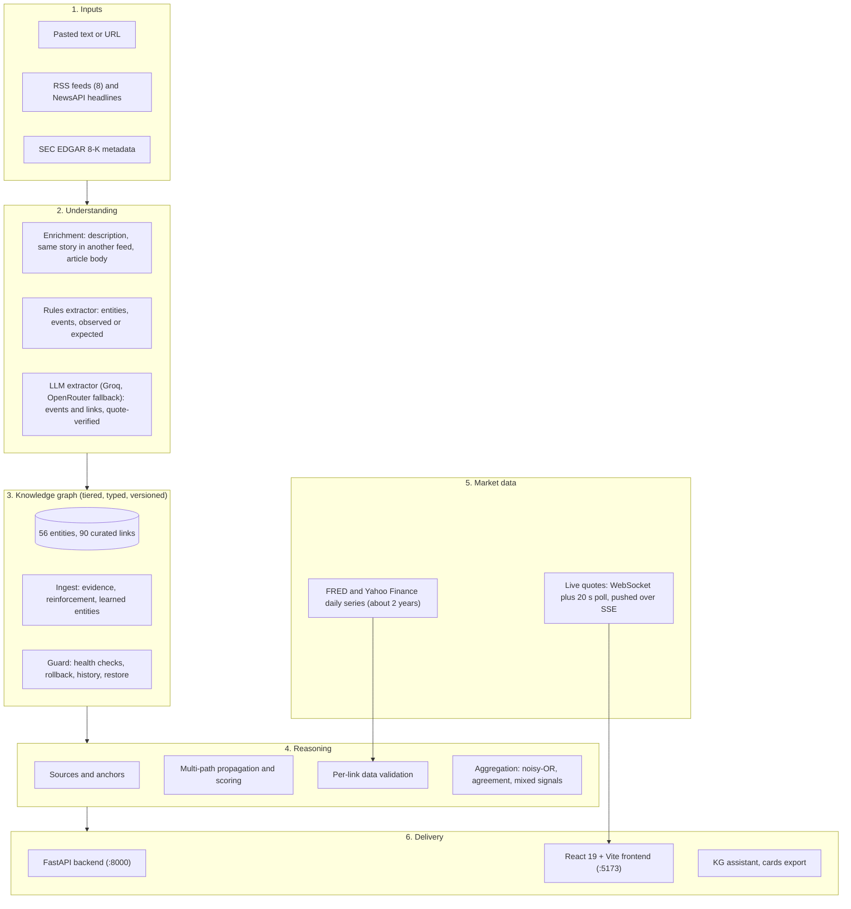

# Apex Zenith: Technical Documentation

Apex Zenith turns unstructured financial news into a **dynamic, explainable dependency graph**: it detects what happened, links the entities involved to a knowledge graph, traces how the event may spread through economic variables, sectors and assets, checks the links against real market data, and explains every connection, while keeping *what the article said* separate from *what the model infers*.

This document describes the software as built (code, data, algorithms, API, UI, tests) and how it answers the problem statement. It was written against the `main` branch (commit `e0be8e1` and later) and checked against the code. A research-paper write-up of the method and its evaluation is in [`research/PAPER.md`](research/PAPER.md); its numbers come from `research/evaluate.py`. Where something is a limitation, an assumption or untested, it says so (see [section 11](#11-known-limitations-and-honest-caveats)).

**Contents**

1. [The problem statement and how this system answers it](#1-the-problem-statement-and-how-this-system-answers-it)
2. [Architecture](#2-architecture)
3. [The knowledge graph variant we built](#3-the-knowledge-graph-variant-we-built)
4. [Pipeline internals and algorithms](#4-pipeline-internals-and-algorithms)
5. [Observed versus inferred, and how uncertainty is communicated](#5-observed-versus-inferred-and-how-uncertainty-is-communicated)
6. [Backend reference](#6-backend-reference)
7. [Frontend reference](#7-frontend-reference)
8. [Configuration, running and data files](#8-configuration-running-and-data-files)
9. [Testing and verification](#9-testing-and-verification)
10. [Demo script](#10-demo-script)
11. [Known limitations and honest caveats](#11-known-limitations-and-honest-caveats)
12. [Roadmap](#12-roadmap)
13. [Glossary](#13-glossary)
14. [Appendix A: the curated entities](#appendix-a-the-curated-entities)
15. [Appendix B: repository layout](#appendix-b-repository-layout)

---

## 1. The problem statement and how this system answers it

### 1.1 The problem

Financial events rarely affect a single company. A geopolitical event, commodity shock, interest-rate decision or regulatory change spreads through sectors and instruments, but most systems show news as isolated stories. The brief asks for an AI system that converts unstructured financial information into a **dynamic dependency graph** showing how an event may influence **economic variables, sectors and assets**.

Its illustrative chain: *crude oil rises 12%, inflation expectations increase, interest-rate expectations shift, banks and real estate may be affected, relevant market indices and assets respond.*

The technical challenge combines NLP, event extraction, knowledge graphs, time-series data, graph algorithms and LLM reasoning, and it requires the system to **distinguish observed facts from inferred relationships and communicate uncertainty rather than present predictions as guarantees.**

### 1.2 Our answer in one paragraph

A pasted article or a live headline is read by a deterministic rules extractor and, in parallel, by an LLM whose output is accepted only if it quotes the article. Stated events become *sources* in a curated, typed knowledge graph of 56 entities and 90 causal links. A depth-limited path search traces how each event may propagate; each link is checked against two years of real FRED and Yahoo Finance data; paths and per-asset scores are aggregated; and every result is explained with the link's economic mechanism, the evidence behind it, the data check, and a one-line reading by tier (*event, variable, sector, asset*). Everything the article states is labelled **observed**, everything the graph derives is labelled **inferred**, and every score is a *plausibility*, never a probability or a price target.

### 1.3 Capability matrix: the brief against the software

| Expected capability | How it is implemented | Where | How it was verified |
| --- | --- | --- | --- |
| **Detect financial events from unstructured information** | Rules find five event types (price move, central-bank decision, supply decision, geopolitical, regulation) and classify each as *observed* or *expected* (hedged). An LLM pass adds events, accepted only when its quote is found in the article. | `extract.py`, `llm.py`, `service.analyze` | `tests/test_pipeline.py` (27 tests), `test_dynamic.py`; live runs on the five built-in samples and real headlines |
| **Extract companies, commodities, sectors, indicators and instruments** | Longest-match alias matcher over 215 aliases of 56 entities (8 node types); unrecognised company names are captured and added as low-confidence entities. | `extract.find_mentions`, `kb.py` | `test_pipeline.py`; entity panel compared with the API in browser tests |
| **Identify and score relationships between entities** | 90 curated links, each with sign, strength, lag and a plain-language mechanism. Article co-occurrence reinforces them, quote-verified LLM links can add new ones, market data adjusts their effective strength. | `kb.py`, `graph.py`, `timeseries.validate_edge` | `test_pipeline.py`, `test_dynamic.py`; every link's numbers compared with the API in browser tests |
| **Construct and update a knowledge graph** | Dynamic graph (NetworkX). Each analysis updates it under a **guard** that runs health checks and rolls back bad changes; every change is recorded, versioned and restorable. | `graph.py`, `kbstate.py`, `changelog.py` | `test_dynamic.py` (22), `test_history.py` (22), `test_tiered_properties.py` (15) |
| **Estimate plausible propagation paths and affected assets** | Depth-limited multi-path search from each source, path scoring, per-node aggregation (noisy-OR with an agreement penalty), asset and sector ranking, what-if and multi-shock scenarios. | `propagate.py`, `service.analyze`, `service.whatif` | `test_pipeline.py`; path scores reproduced from their links in `test_hierarchy.py` |
| **Incorporate time-series data where available** | FRED and Yahoo Finance daily series (about 520 trading days) validate each link by lagged correlation; live quotes; a volatility fan and past-move analogs per asset. Simulated data is allowed only as a clearly labelled demonstration and never changes confidence. | `timeseries.py`, `quotes.py`, `forecast.py`, `analogs.py`, `market.py` | `test_forecast.py`, `test_analogs.py`; real series checked against the API in browser tests |
| **Explain each impact chain and the evidence behind it** | Every path lists each hop's mechanism, basis (prior, observed, LLM, data-supported), data check and article quote. A *tier sentence*, a step-by-step walkthrough whose arithmetic reproduces the score, an executive memo, and a question-answering assistant that cites its sources. | `service._explain_path`, `hierarchy.py`, `cards.py`, `assistant.py`, frontend | `test_hierarchy.py`, `test_step3.py`, `test_assistant.py`; browser tests compare displayed numbers with the API |
| **Distinguish observed from inferred; communicate uncertainty** | See [section 5](#5-observed-versus-inferred-and-how-uncertainty-is-communicated). | throughout | `test_pipeline.py`, `test_caveats.py` |

### 1.4 Worked example: the brief's own chain, run on the system

Input: *"Crude oil rose 12% on Monday after an attack on tankers in the Strait of Hormuz."* (analysed with cached real market data, rules plus the graph; output below is real, abridged.)

**Extracted events:** `Crude Oil up 12%` (observed, rules) and `Geopolitical escalation (attack)` (observed, rules).

**One of the traced chains**, as the system reads it tier by tier:

```
Event: Crude Oil up 12% → Variable: Crude Oil ↑ → Variable: Inflation Expectations ↑
  → Variable: Interest-Rate Expectations ↑ → Sector: Real Estate ↓      plausibility 0.424, typical lag 31 days
```

| Hop | Effective strength | Per-link decay | Lag | Basis | Data check |
| --- | --- | --- | --- | --- | --- |
| Crude Oil → Inflation Expectations | 0.931 | 1.00 (first hop) | 2 d | analyst prior; supported by data | supported, r = 0.482 over 504 days |
| Inflation Expectations → Interest-Rate Expectations | 0.847 | 0.93 | 8 d | analyst prior; supported by data | supported, r = 0.421 over 519 days |
| Interest-Rate Expectations → Real Estate | 0.705 | 0.82 | 21 d | analyst prior; supported by data | supported, but weak (r = −0.17 over 495 days) |

`0.931 × (0.847 × 0.93) × (0.705 × 0.82) = 0.424`: the displayed score is exactly the product shown, and the weak data support is why the last hop decays at 0.82.

**Resulting assets and sectors for this input** (direction, confidence label, number): Airlines ↓ (high, 0.92), S&P 500 ↓ (high, 0.67), TLT ↓ (high, 0.66), Real Estate ↓ (high, 0.62), Nifty 50 ↓ (high, 0.52), **Banks ↑ (low, 0.25, flagged "mixed signals")**.

The last row matters: the brief says banks "may be affected", and the system reports that honestly. Competing paths reach Banks with opposite signs, so confidence is cut and the node is flagged as mixed instead of being given a confident direction.

---

## 2. Architecture

### 2.1 System view



### 2.2 The life of one analysis (`Analyzer.analyze`)

1. **Receive** `POST /api/analyze {text, live, use_llm, title?, link?, full_text?}`.
2. **Enrich the input.** A URL is read by the safe article reader. A headline from a feed goes through the enrichment chain (feed description, then the same story in another feed by title similarity, then the article body, then the page's meta description). The result is labelled `article`, `description` or `headline_only`.
3. **Extract with rules** (`extract.extract`): entity mentions with character offsets, events with direction, magnitude and observed or expected status, and unrecognised company names.
4. **Extract with the LLM** (`llm.extract_graph`): extra events and links. Each is kept only if its quote appears in the article. `ZENITH_REQUIRE_LLM=1` (the default) makes this step mandatory: if it fails, the analysis returns an error rather than silently degrading.
5. **Update the graph** (dynamic mode only) inside a guarded change: ingest evidence and entities, add verified LLM links, run the health checks, roll back on failure, record a history entry.
6. **Build sources.** Observed price moves become *anchored* sources; observed decisions and events become sources; expected (hedged) price moves become *claims* to compare with the model.
7. **If nothing was stated**, either return an honest empty state with the reason, or (LLM available) ask for hedged *themes* that are drawn dashed and never ingested.
8. **Propagate, then validate.** Pass 1 propagates on priors. The edges of the strongest 80 paths are checked against real series. Contradicted runtime links are pruned. Pass 2 propagates again with data-adjusted strength and lag.
9. **Aggregate** per node into asset, sector and variable rows; choose and explain the top 40 paths.
10. **Compare** the model with what the article stated; add thin-graph context; build the graph view and the hierarchy roll-up; write the summary (LLM, constrained to the supplied facts) and the caveats.
11. **Return** one JSON result carrying the graph version it ran on (`kb_version`).

Typical latency, observed on 2026-10-11 with the LLM on: **13 to 35 seconds**, dominated by the LLM call (the layer waits out a rate limit for up to 30 s by design). All other endpoints answer in about 0.2 seconds.

### 2.3 Technology

| Layer | Choice |
| --- | --- |
| Backend | Python 3.9, FastAPI, Uvicorn, NetworkX, NumPy, Requests, yfinance, pandas, BeautifulSoup |
| LLM | Groq (`openai/gpt-oss-120b` by default), with OpenRouter (`meta-llama/llama-3.3-70b-instruct`) as automatic fallback |
| Market and news data | FRED (official API if a key is set), Yahoo Finance (yfinance, including its WebSocket), NewsAPI, 8 RSS feeds, SEC EDGAR |
| Frontend | React 19, Vite, lucide-react, driver.js (product tour); hash routing, no router library |
| Persistence | Local files only: `data/kb_state.json`, `data/watchlist.json`, `data/cache/`; chat history in the browser's `localStorage` |

---

## 3. The knowledge graph variant we built

### 3.1 Why a variant

Two textbook designs were considered and measured against this problem.

* A **flat knowledge graph** (nodes and links, nothing more) is simple and flexible, but gives the reader no structure: nothing says what *level* of the economy a node sits at, what a link *means*, or how a node relates to the sector it belongs to.
* A **strict hierarchical graph** (events → variables → sectors → assets, links allowed only one level down) is easy to explain, but the economy is not that tidy, and enforcing it destroys results.

We built a middle design: a **tiered property graph with typed, provenance-carrying links**. Every node carries a *tier*; every link carries a *relation type*, its *basis* (where its support comes from) and its *tier crossing*; but links are **not restricted** by tier. Tiers add information and structure the explanation; they do not block anything, apart from one hard rule (no *learned* link may point up from an asset).

**Why not strict tiers: a measurement.** The curated graph's links were re-run under progressively stricter rules over 10 articles (the 5 built-in samples plus 5 more: a Fed hike, an OPEC cut, an RBI cut, a gold and dollar story, a Delta fuel warning), comparing the assets reached with today's graph:

| Rule applied | Links left (of 90) | Asset results lost (of 182) | Direction flips | Top-5 assets kept |
| --- | --- | --- | --- | --- |
| Flat graph (today) | 90 | 0 | 0 | 100% |
| No feedback links | 88 | 2 | 0 | 100% |
| No tier skips | 81 | 22 | 12 | 62% |
| No feedback, no skips | 79 | 24 | 12 | 62% |
| Strict layers (next tier only) | 54 | 113 | 4 | 49% (2 of 10 articles reach no asset at all) |

The numbers are reproduced by `research/evaluate.py` (experiment E2) with learning switched off, rules-only extraction and cached real data, so the result does not depend on the order the articles are read in. (A first run of this study with learning on between articles gave 182 results, 112 lost under strict layers, and a flat-graph top-5 overlap of 90%: that 10% was the effect of learning, not noise.)

Two facts explain it. 65% of all paths use a *lateral* link and 51% of assets' best paths do (oil → inflation → rates → yield is a chain of variables, and it is the brief's own example). And 17% of paths use a *tier skip* (28% of assets' best paths): indices and funds such as the S&P 500 or a bond ETF belong to no sector, so rates and yields reach them directly. Forbidding feedback links costs almost nothing (only 2 exist), so that is the one rule we adopted, for learned links.

### 3.2 The four tiers

| Tier | Name | Node types | What it is |
| --- | --- | --- | --- |
| 0 | Events & policy | `event_class`, `institution` (and the events an article reports) | Causes: a geopolitical shock, a supply decision, a central bank |
| 1 | Economic variables | `commodity`, `indicator` | Quantities that move: crude oil, inflation expectations, the 10-year yield, the dollar |
| 2 | Sectors | `sector` | Groups of companies: airlines, banks, oil and gas producers |
| 3 | Assets | `company`, `index`, `instrument` | What an investor can hold: Delta, the Nifty 50, a gold ETF |

The tier of every node is derived from its type (`hierarchy.layer_of`) and stored on the node. Nothing about it is learned or guessed.

### 3.3 Nodes

| Property | Meaning |
| --- | --- |
| `id`, `label`, `type` | Identity and type (8 types) |
| `tier` | `event`, `variable`, `sector` or `asset` (stored) |
| `origin` | `curated` (baseline), `learned` (created from an article), `user` (added in the app) |
| `market` | `US`, `IN`, `GLOBAL`, or `unknown` for a learned entity |
| `first_seen` | Date the node appeared (empty for curated nodes) |
| `articles` | Ids of analysed articles that mention it (last 20) |
| `series`, `kind` | Market series available for it (FRED or Yahoo), and how it is measured |
| `inferred`, `user_added` | Flags for non-curated nodes |

Derived, tier-specific properties are served by `GET /api/node/{id}`: a **variable** shows how it is measured (percent return, or change in percentage points) and whether it has real market data; a **sector** shows its members and the indices it weighs in; an **asset** shows its ticker, parent sector, the variable it tracks and the index it belongs to; an **event** shows what it affects and whether it is a policy body.

### 3.4 Links

| Property | Meaning |
| --- | --- |
| `sign` | +1 if the source rising pushes the target up, −1 if down |
| `strength` | 0.01 to 0.99, an **analyst prior** (a judgement of how plausible and material the link is), *not* an estimated coefficient |
| `base_strength` | The stored strength before any data adjustment |
| `lag` | Typical days before the effect shows (0 to 60 in the curated graph) |
| `mechanism` | One plain-language sentence explaining why the link exists |
| `provenance` | Where support comes from: `prior`, `observed`, `llm_extracted`, `llm_proposed`, `validated`, `inferred`, `user_added`, `user_edited` |
| `evidence` | The article sentences that support it (with article id and date) |
| `validation` | The latest data check (verdict, correlation, lag, sample size, data series, simulated flag) |
| `relation` | What the link *means* (below) |
| `inferred` | True for links added at run time |

**Relation types** (stored, assigned when a link is created; `hierarchy.relation_for`):

| Relation | Meaning | Curated count |
| --- | --- | --- |
| `causes` | The source moving pushes the target (the default; every LLM-proposed link is this) | 58 |
| `member_of` | A company belongs to a sector | 15 |
| `weight_in` | A sector or company is a component of a broad index | 7 |
| `tracks` | A fund or sector index follows a sector, commodity or yield | 6 |
| `policy_reaction` | An institution's decision reprices a variable | 4 |

Sector membership is read from these relations, not from text, so a sector can be drilled down to its members and an asset a user adds to a sector is a member too.

**Tier crossing** (derived from the endpoints, shown as information, never enforced except where noted):

| Kind | Meaning | Curated count |
| --- | --- | --- |
| `next` | Goes exactly one tier down | 54 |
| `lateral` | Stays in one tier (variable to variable chains) | 25 |
| `skip` | Goes more than one tier down (a rate expectation straight to an index) | 9 |
| `feedback` | Goes back up (banks to GDP growth, banks to consumer spending) | 2 |

### 3.5 The curated content

56 entities and 90 links, written by hand as priors (`kb.py`): 13 variables (5 commodities and 8 indicators), 13 sectors, 24 assets and 6 event-level entities (Appendix A lists them all). 31 nodes are global, 15 Indian, 10 US; 48 of 56 have a market series. 65 links are positive and 25 negative, with strengths from 0.15 to 0.98. All 90 curated links start with provenance `prior`: the graph begins as assumptions and earns its other labels from articles and data.

### 3.6 Basis: how each link is supported

For explanation, each link on a path counts under the **strongest claim that applies**, in this order:

1. **added or edited by a user**
2. **contradicted by market data** (a real, non-simulated check with the opposite sign)
3. **observed in the article** (the article mentioned both endpoints in a sentence)
4. **supported by market data**
5. **proposed or read by the LLM** (quote-verified)
6. **analyst prior only**

### 3.7 How the graph learns (dynamic mode)

* **Article evidence:** when two linked entities appear in one sentence, the sentence is stored as evidence on the link, the link gains `observed`, and its strength moves a small step toward 0.97: `strength += (0.97 − strength) × 0.05`.
* **LLM evidence on an existing link:** same idea with a weaker step, `× 0.03`. A prior's **sign is never flipped** by the LLM: an opposite reading is logged as a conflict and the prior is kept.
* **New LLM link:** added with strength 0.35, lag 1 day and provenance `llm_proposed`, only if its quote is at least 15 characters and is found in the article.
* **New entity:** an unrecognised company name (a capitalised name ending in Inc, Corp, Airlines, Bank, and similar) becomes a node with origin `learned`, linked to a sector only if the name suggests one, at strength 0.5, marked inferred.
* **Static mode** freezes the graph at the curated baseline: nothing is learned or stored.

### 3.8 The guard

Every change to the graph (an article, an edit, an added asset, a restore) is a *guarded change*: a snapshot is taken, the change is applied, the health checks run, and a failing change is **rolled back automatically**.

| Check | Rule |
| --- | --- |
| Curated entities present | None of the 56 may be missing |
| Curated links intact | Each curated link keeps its sign (unless the user deliberately edited it) |
| Strengths in range | 0 < strength ≤ 0.99 |
| No self-loops | No link from a node to itself |
| No learned link points up from an asset | The one hard tier rule |
| Runtime links stay a minority | At most 35% of all links |
| Growth per change bounded | At most 8 new links and 6 new entities per change |
| Baseline regression | The built-in samples must still conclude the same: at least 90% sign agreement over conclusions with confidence ≥ 0.3, and at least 90% recall of conclusions ≥ 0.5 |

A **deliberate user edit** is judged on structure only: the baseline regression is skipped (the user is choosing to depart from the baseline) and the edited link is marked `user_edited`. Runtime links that real market data contradicts are dropped (`heal`); user-added links are never auto-removed.

### 3.9 Editing, history and versions

Every change produces one **history entry** (`changelog.py`): an id, the version it started from and produced, who made it (`user`, `system`), the action (`ingest`, `edit_link`, `add_link`, `remove_link`, `move_asset`, `add_asset`, `remove_asset`, `restore`, `undo`, `reset`, `import`), a one-line summary, the user's reason if given, **which tiers it touched**, and an **exact diff computed by comparing the graph before and after** (entities and links added or removed; every changed field with its before and after). The diff cannot drift from what actually happened.

* **Restore:** `POST /api/kb/restore {version}` brings back the graph as it was at one of the last 30 versions of the session. A restore is a **new forward version**, so nothing is erased. Older entries stay readable but cannot be restored. A reset to the curated baseline starts a new epoch and keeps the earlier history.
* **Undo** removes the last change (marked `undone` in the history); `revert static` returns to the baseline.
* **Tier-aware edits:** add a link, dry-run a link, remove a link you added, move a user-added asset to another sector, edit a link's weight. Tiers give *warnings* (a link that skips a tier, stays within one, or goes back up) and one *block* (nothing may point up from an asset). Curated links cannot be removed and curated sector memberships cannot be moved: edit a weight or add a link instead.
* **Export and import** the whole graph as JSON; an import must pass the health checks and the tier rules or nothing changes.
* **Every analysis records the graph version it ran on** (`kb_version`), so a result can be reproduced.

### 3.10 Derived views of the graph

* **Hierarchy roll-up** (`hierarchy.rollup`): for each tier, the count of affected nodes, how many went up, down or are mixed, the top items, and a **drill-down from each affected sector to its member assets**. It only re-groups impact rows the analysis already produced.
* **Evidence mix** (`hierarchy.evidence_mix`): for each tier, how the links *arriving* at it are supported (the basis categories above), over the distinct links on the analysed paths. It re-groups what the graph records; it is not a probability.
* **Tier sentence:** one line per path and per asset, for example `Event: Airlines down → Sector: Airlines ↓ → Asset: Delta Air Lines ↓`.
* **Cards** (`cards.py`): the graph as **citable text documents**: tier, sector, node and link cards with stable ids (`n:<node>`, `l:<from>><to>`, `s:<sector>`, `t:<tier>`; path cards `p:a>b>c` are rebuilt from their id). Every fact is taken from the graph, so the same graph always yields the same cards. An export is pinned to the graph version and carries a **fingerprint** that changes exactly when the graph's facts change. The assistant and the export read the same card builders, so a retrieval system and the chatbot see the same text. Every saved analysis also has a card (`a:<id>`, section 4.14), available from `GET /api/kg/cards/a:<id>` and in the export with `analyses=true`; analysis cards are not part of the fingerprint, which covers the graph's own facts only. No embeddings or vector search are included.

### 3.11 What this variant is, and is not

It *is* a typed, explainable, auditable causal map with analyst priors, article evidence and data checks. It is *not* a probabilistic graphical model: the strengths are judgements, scores are plausibility, and nothing is calibrated against historical outcomes. Correlation checks do not establish causation, and relationships change across market regimes.

---

## 4. Pipeline internals and algorithms

### 4.1 Input and enrichment (`feeds.py`, `enrich.py`)

* **Headlines:** 8 RSS feeds (CNBC Markets, MarketWatch, ET Markets, ET Economy, ET Industry, Livemint, The Hindu BusinessLine, Times of India Business) fetched in parallel, plus NewsAPI business headlines for the US and India; results are interleaved round-robin so the first few span publishers and both markets. Moneycontrol, Business Standard and NDTV were left out because they refuse automated access. Caches are **stale-while-revalidate**: an expired list is served at once while a background thread refreshes it. NewsAPI's developer plan allows 100 requests a day; on a 429 the layer backs off for 30 minutes and RSS keeps working.
* **Enrichment chain** for a headline: its own description (≥ 60 characters of real text) → the same story in another feed (title similarity ≥ 0.85; looked for when the text is under 120 characters) → the article body → the page's meta description. The quality is reported (`article`, `description`, `headline_only`).
* **Safe article reader:** public hosts only (checked on every redirect, so no localhost, private networks or cloud metadata), `robots.txt` honoured, an honest User-Agent, a 1.5 MB size cap, at most 5,000 characters used, nothing stored. Paywalled pages fall back to the description.
* **SEC EDGAR:** `GET /api/sec` returns 8-K filing metadata (date, item codes with labels, link) and the company's industry; no UI uses it yet.

### 4.2 Extraction (`extract.py`, `llm.py`)

**Rules** (deterministic, offline, explainable):

* **Entities:** longest, non-overlapping match over 215 aliases (funds also by everyday names such as "long-term bonds" or "gold ETF"); case-sensitive tickers are marked (`!VIX`, `!INR`).
* **Price moves:** an up or down verb near an entity (102 verb forms; noun and adjective uses such as "the increase", "more hikes" or "higher capital requirements" are rejected), or a causative verb + entity + up/down ("sending Brent crude up 6%"), with the nearest percentage within 40 characters (a figure before the verb must come after the entity, so a neighbour's figure is not borrowed). An entity followed by a quantity noun ("oil output", "crude exports") is not a price move. Confidence = 0.6, +0.2 if a number is found, +0.1 if the verb directly follows the entity.
* **Observed or expected:** a hedge word before the verb or the entity, whichever comes later (could, may, expected to, analysts warn, if, risk of, forecast, …), makes the event *expected*; otherwise *observed*.
* **Intensity** (how big the shock is): `tanh(percent / 8)` clamped to 0.25 to 1.0, 0.5 when no number is stated, and ×0.7 when expected.
* **Central-bank decisions** (confidence 0.8), **OPEC+ supply decisions** (0.75), **geopolitical shocks** (0.5 to 0.7; "attack", "blockade", "sanctions", "escalat…" are strong, "war", "tensions" weak, "ceasefire" eases) and **regulation** aimed at a sector or company (0.55; the market of the regulator scopes the effect) are detected from their own vocabularies.

**LLM** (`llm.py`): one structured call returns events and links together. Validation is strict: a trigger must be a known node, direction must be ±1, **a quote that is not found in the article rejects the item**, and a link needs a known source and target, a sign, and a quote of at least 15 characters found in the text. Providers are tried in order (Groq, then OpenRouter); a rate-limited provider is skipped for the next, and if all are limited the layer waits out the shortest limit up to 30 seconds. Other LLM uses: the constrained summary, hedged *themes* for texts that state nothing recognisable, a sector suggestion for an added asset, and the assistant's answers.

### 4.3 Sources and anchors

An **observed price move** is an *anchor*: the article reports it as having happened, so propagation from other sources stops at it (the model can then be compared with what actually happened) and it becomes a source itself, so its downstream effects are traced from the reported move. Observed decisions and events are sources without being anchors. **Expected price moves are not propagated**: they become claims that are compared with the model. When an observed move and a cause-event sit on the same node in the same direction they are merged, so nothing is counted twice.

### 4.4 Propagation and scoring (`propagate.py`)

* **Search:** depth-limited depth-first search, simple paths only (a node is never revisited on a path), maximum 5 hops, minimum score 0.04, up to 300 paths per source. A regulator's action is scoped to its own market.
* **Path score** (a 0 to 1 plausibility score):

```
score(path) = Π over hops of  effective_strength(hop) × decay(hop)         decay = 1 on the first hop
effective_strength = min(0.99, strength × data multiplier)                 multiplier 1.0 to 1.25 if supported, 0.55 to 1.0 if contradicted, 1.0 otherwise
decay (per link)   = 0.97 if |r| ≥ 0.50 · 0.93 if 0.30 ≤ |r| < 0.50 · 0.82 if weaker or contradicted · 0.92 if untested
```

  where *r* is the link's validated correlation (section 4.5). A well-supported link attenuates the chain less; an untested one gets a conservative 0.92. The walkthrough in the UI shows exactly these numbers and they reproduce every path's score (a test asserts it for all paths).
* **Lag:** a path's typical delay is the sum of its links' effective lags (section 4.5).
* **Aggregation per node** (`aggregate`): over all paths ending at a node,

```
positive mass  = Σ score of paths with sign +      negative mass = Σ score of paths with sign −
miss           = Π over the best 4 paths of (1 − score)               # noisy-OR
confidence     = min(0.92, 1 − miss)  ×  (0.5 + 0.5 × agreement)
agreement      = max(pos, neg) / (pos + neg)
mixed signals  = agreement < 0.70 and the smaller mass ≥ 0.02          # shown with a ± badge
direction      = + if positive mass ≥ negative mass, else −
sensitivity    = intensity of the source × best path score             # strong ≥ 0.40, moderate ≥ 0.18, else mild
confidence label: high ≥ 0.5, moderate ≥ 0.25, low below
```

  Noisy-OR over paths that share links overstates independence, hence the 0.92 cap and the agreement penalty.
* **Ranking for display:** informative multi-hop chains are favoured over one-hop "member of" links; the strongest 40 distinct paths are explained.
* **Upstream search** (`upstream_paths`): the same search walked backwards ("what could have produced this move?"). It is abductive evidence, weaker than forward propagation, and is always presented as a hypothesis.

### 4.5 Time-series validation (`timeseries.py`)

* **Data:** about 520 trading days (roughly two years) of daily series: FRED (official API if `FRED_API_KEY` is set, else the public CSV) and Yahoo Finance, cached on disk for 6 hours. Yields and expectations are stored as **changes in percentage points**, prices as **returns**. Concurrent Yahoo downloads are serialised (the library shares global state) and a circuit breaker stops hammering a failing source.
* **Modes** (shown as source tags): `live`, `live (cached …)`, `cached`, `cached (stale …)`, and `simulated`.
* **Simulated data is a demonstration only.** When no real series exists, a clearly labelled synthetic series is used; it is marked, **never changes a link's confidence**, and is refused entirely by the forecast.
* **Link check** (`validate_edge`): correlation of the source's and target's moves at lags of 0 up to `min(10, max(2, 1.5 × the link's lag + 1))` days, taking the shortest lag among near-ties. The significance threshold is `2.8 / √n`. Verdicts: `supported` (right sign; multiplier `1 + min(0.25, |r|/2)`), `contradicted` (wrong sign; `max(0.55, 1 − |r|)`), `inconclusive` (below threshold; ×1), `same_series` (both ends use one series, as for a member or ETF link: not independent evidence), `no_data`.
* **Dynamic lag:** the link's lag is blended with the measured lag (weight `min(0.7, |r|)`) and scaled by the volatility regime, computed as the last 30 days' volatility over the full window: ≥ 1.35 *high* (×0.65), ≥ 1.15 *elevated* (×0.85), ≤ 0.80 *low* (×1.25), else normal. A zero-lag link (membership, index weight) stays instantaneous.

### 4.6 Comparing the model with the article

For each stated event the system compares the direction the model predicts for that entity with what the article said, with verdicts `consistent`, `contradicts`, `model_mixed`, `no_upstream_path` or `model_has_no_path`. Expected claims are compared the same way, so "analysts warn airlines will fall" can be checked against the graph.

### 4.7 Thin graphs: context and hypotheses (`context.py`, `llm.suggest_themes`)

* When a story states a move but little downstream (fewer than 14 entities reached), the system adds **context**: possible *drivers* traced backwards (up to 8) and *sector peers* or index composition, all drawn dashed and labelled as hypotheses; none is learned.
* When a text states **nothing recognisable**, the LLM may suggest hedged *themes* the story could touch, each with the quote that supports it and a background note; they form a dashed hypothesis graph (at most 20 paths) and are never ingested into the knowledge graph. If nothing can be drawn the page says why and what to try.

### 4.8 What-if and scenario simulation

`POST /api/whatif` re-runs propagation for a hypothetical shock (or several at once) without ingesting anything. The shock's intensity is `tanh(|%| / 8)`, clamped. With **multiple shocks** the engine reports, per asset, the positive (tailwind) and negative (headwind) mass and the net verdict, so opposing forces are shown colliding instead of cancelling silently. The Scenario Simulator page compares scenarios (reversed, half-size, double) and presets; its presets are stated as *what-if assumptions, not reported events*. Scores change with shock size only through sensitivity and ranking; path plausibility does not scale linearly with the shock.

### 4.9 Volatility fan and analogs (`forecast.py`, `analogs.py`)

* **Forecast** (`GET /api/forecast`): geometric Brownian motion with **zero drift**, volatility measured on the asset's **real** daily returns (at least 120 required), 500 paths by default, 10 to 90 days. The day-0 shock is an **assumption the user sets** (default: the move the article states for that asset, else 0), never derived from the graph's scores. It **refuses, with the reason shown**, when only simulated data exists, when the series is a yield or expectation (stored in percentage points), when the node has no series, or when history is too short or flat. Outputs: percentile bands, VaR and expected shortfall at 95%, probability of ending below the start. It states that real markets have fatter tails than the model. Verified on cached real data: Brent 49.6% annualised volatility over 520 returns; S&P 500 15.8%.
* **Analogs** (`GET /api/analogs`): past 5-day windows on the same asset whose move was at least the threshold (up to 4, skipping the last 95 days), shown rebased to 100 with the following 90 days. Windows are labelled only by date ("Move on 2026-04-20"): no event names are invented. With fewer than 10 episodes the page says it is a small sample, not a probability.

### 4.10 Live market data (`quotes.py`, `market.py`)

Yahoo offers no webhooks, so two real feeds are combined: yfinance's WebSocket (a tick whenever a symbol trades) and a batched poll every 20 seconds (which supplies the previous close and covers closed markets). Both feed one cache, pushed to browsers over **Server-Sent Events** (`/api/stream`), with `/api/quotes` as a polling fallback. Prices are never simulated; if Yahoo throttles, the last good quote stays visible with an error and its age. A watchlist of any Yahoo ticker is validated with a real quote before it is saved. `market.py` supplies six headline levels from FRED (S&P 500, NASDAQ, Dow, Brent, US 10Y, VIX).

### 4.11 The KG assistant (`assistant.py`, `cards.py`)

`POST /api/assistant {question, history}` answers a question from the graph and **never changes it** (a question is never analysed as an article). The steps:

1. **Find the entities** in the question with the same alias matcher; a *real follow-up* ("and what about it?") may borrow the previous question's subject, an unrelated question may not.
2. **Retrieve graph cards**: an entity card for each, link cards and path cards between entities, or, for one entity, up to five downstream chains chosen to cover different channels (below) and its strongest drivers; a *gap* card when the graph holds no path between two entities (so the answer is "the graph does not say"), together with a *shared-drivers* card (`d:a&b`) when something moves both: for Gold and TLT, rate expectations push both down and risk aversion pushes both up, while inflation expectations push them apart. The card says this is co-movement through common causes, not an effect of one on the other; a driver that acts only through one already listed (the Fed through rate expectations) is left out.
3. **Retrieve saved analyses** from the analysis library (section 4.14): up to three *analysis cards* (`a:<id>`) for the most recent articles that touched the named entities, or, for a question about the news ("which articles…", "what did the last article report?"), the latest ones. "The last / latest / this article" means exactly the newest one. An analysis card keeps apart what the article **reported** (observed events with their quotes), what the model **inferred** at the time (chains, affected assets, on a stated graph version, with a note if the graph has changed since) and the model's **hypotheses**.
4. **Ask the LLM to answer from those cards only**, citing card ids in brackets, saying what kind of basis supports each claim, never presenting an inference or hypothesis as something an article reported, and never stating a price move.
5. **Verify the answer:** invented citations are stripped; an answer with no valid citation gets one retry (the model is shown its answer and asked to cite the cards), and if it still cites nothing it is replaced by a plain answer built from the cards; with no LLM, the cards themselves are the answer. A question naming no graph entity and not about the news gets suggestions, not an answer.
6. **Return** the answer, the cited sources (title, kind, text), the graph version it was answered from, and how many graph and analysis cards were considered.

**Diverse chains for one-topic questions.** A chain's score is a product of strengths, so the strongest chains out of one entity are short and
share its strongest first link. For "what happens if X rises?" the assistant therefore takes the strongest chain through each *different*
first link, then (when slots remain, e.g. for a central bank whose only link is to rate expectations) through each different second link,
then the next strongest, up to five, and makes sure one chain runs through another economic variable when the graph has one.

**Measured retrieval** (`research/evaluate.py`, E8). For a question naming two entities, retrieval returns the strongest chain between them
for all 450 connected driver-target pairs in the curated graph, including 306 chains of 3 to 5 links; an unconnected pair gets a gap card.
For one-entity questions, before the diversification all three retrieved chains shared one first link for 10 of 18 drivers (for crude oil, all
three were oil → producers → XLE, Exxon, Chevron, so the inflation and rates channels never reached the language model). After it: every driver
uses each of its usable first links (18 of 18, was 11), up to 5 chains (median 5, was 3), and 15 of 18 reach another economic variable (was 14).
Crude oil now covers producers, airlines, inflation, consumer spending and autos.

### 4.14 The analysis library (`library.py`)

The knowledge graph keeps only what an article *teaches* it (evidence on links, learned entities). The analysis itself (what the article
reported, the chains traced, the assets ranked, the hypotheses drawn) used to live only in the browser, so the KG assistant could not see it.
The analysis library keeps every graph the Knowledge Graph Generator produces on the backend:

* `POST /api/analyze` files each analysis that found at least one event. The record id is the article id (a hash of the analysed text), so
  re-analysing the same text replaces its record (`runs` counts how often). The newest 200 are kept.
* Storage: `data/analyses/index.json` holds one compact record per analysis (title, time, excerpt, link, input quality, graph version,
  events with status and quote, top 6 paths, top assets, sectors and variables, the model-vs-article checks, hypotheses, the summary, and
  the graph nodes it touched, used for retrieval); `data/analyses/<id>.json.gz` holds the full result without sparklines (about 180 KB
  before compression), so a saved graph can be reopened with every dashboard. Nothing is written on serverless hosts (kept in memory).
* **Import:** `POST /api/analyses/import` takes analyses from the browser's chat history (the *Import my chat history* button on the KG
  assistant page sends them in batches of 25, without sparklines). Ids already in the library are kept as they are.
* **Recent chats** in the sidebar list this browser's chats *and* library graphs this browser does not hold (marked with a library icon).
  Clicking one reopens it as a chat with all dashboards; deleting it removes it from the library. *Clear* removes only the browser's chats.
* The library never changes the knowledge graph. It is shared by everyone using the same backend; there is no per-user separation.

### 4.12 Portfolio contagion and hedge finder (`hedge.py`, contributed module)

`POST /api/portfolio/hedge` applies an analysis to a list of holdings, computes a profit and loss per holding and for the portfolio, a 30-day VaR, and ranks counter-hedges drawn from a fixed candidate list. **Read [section 11](#11-known-limitations-and-honest-caveats) before relying on its numbers:** several of its figures are heuristics or constants rather than measurements.

### 4.13 Headline priority scoring (`priority.py`, contributed module)

A scorer that ranks articles in a duplicate cluster to choose the primary headline: `P = 0.5 × trust + 0.2 × speed + 0.3 × quality`, where trust is a hand-set authority score per publisher (matched on whole words, longest name wins), speed decays exponentially with a 6-hour half-life (a missing or unreadable timestamp scores a neutral 0.5), and quality combines length, attribution (paired quotation marks of at least 8 characters, or an attribution verb next to quoted speech or a named speaker) and headline richness.

**Duplicate clustering (wired in since `e0be8e1`).** `feeds.headlines()` now fetches about twice the requested number of items, groups
items that report the same story across feeds, and keeps one primary headline per group, chosen by the priority score. Two titles are
the same story when their similarity is at least 0.60, where similarity is the larger of the character-sequence ratio and
`0.3 × sequence ratio + 0.7 × keyword Jaccard` (stop words removed), raised to 0.70 when at least 60% of the shorter title's keywords
(and at least 3) or 50% (and at least 4) are shared. Clustering is greedy: each item joins the most similar existing cluster above the
threshold. Groups are then ordered by their primary item's priority score, and each carries `cluster_size`, the list of `sources`, the
score breakdown and the duplicates. `GET /api/events` returns these fields (`deduplicate=false` turns clustering off), and Market
Intelligence shows an "N sources" badge on a clustered headline. The authority scores and the thresholds are hand-set; the clustering
has unit tests but has not been measured on a labelled set of real feed items.

---

## 5. Observed versus inferred, and how uncertainty is communicated

The brief's technical challenge is honesty about what is known. The design makes this structural, not cosmetic.

| Distinction | Mechanism | Where the user sees it |
| --- | --- | --- |
| **Observed** (the text reports it happened) vs **expected** (hedged) | Hedge-word classifier; only observed price moves anchor propagation | Event Diagnostics: "observed" or "expected" on each event with its source quote |
| **Stated** vs **derived** | Everything propagated is *inferred*; stated events are anchors | Graph: observed nodes carry an anchor ring; inferred nodes do not |
| **Article-supported** vs **analyst prior** vs **LLM-proposed** vs **data-supported** | `provenance` on every link and the basis categories | Node Details provenance badge; evidence mix per tier; tooltips |
| **Model hypotheses** | Dashed nodes and links, never ingested | Impact Graph legend: "Hypothesis: possible driver / context (not in the article)" |
| **Scores are plausibility, not probability** | Naming, captions and caveats everywhere; no percentage price move is derived from a score | "heuristic, not a price forecast" captions; caveats list in every result |
| **Confidence is lowered when paths disagree** | Agreement penalty; "mixed signals" flag | ± badge; "mixed" in tables; Banks in the worked example |
| **Real vs simulated data** | `simulated` flag; simulated data never changes confidence and is refused by the forecast | Source tags: LIVE (market data), FRED, MODEL (graph estimate); "simulated" shown on the check line |
| **What the model got right or wrong about the article** | Model-vs-article comparison | Event Diagnostics: "3 of 3 agree with the graph" and per-statement verdicts |
| **No answer instead of an invented one** | Honest empty states; the assistant says "the graph does not say"; forecast and analog refusals state the reason | Empty-state messages with the reason and a hint |
| **Correlation is not causation** | Stated in the caveats of every analysis | Caveats section |

User-adjustable assumptions (a shock size in the forecast, a link weight, a scenario) are always labelled as the user's assumption, not a model estimate.

---

## 6. Backend reference

### 6.1 Modules (`impactgraph/`)

| Module | Lines | Responsibility |
| --- | --- | --- |
| `service.py` | 691 | `Analyzer`: the orchestration above; what-if; guarded edits; summary and caveats |
| `kb.py` | 287 | The curated entities, aliases, series and 90 links; relation overrides; simulated-data loadings; sector keywords |
| `graph.py` | 195 | `KnowledgeGraph` (NetworkX): seeding, effective strength and lag, ingest, LLM links, added assets, JSON view |
| `hierarchy.py` | 370 | Tiers, relations, tier crossing, node properties, roll-up, evidence mix, tier sentence, edit rules |
| `changelog.py` | 102 | The before/after diff and the history entry |
| `kbstate.py` | 358 | `KBGuard`: health checks, snapshots, rollback, history, restore, export and import, persistence |
| `propagate.py` | 187 | Path search, per-link decay, aggregation, upstream search |
| `extract.py` | 305 | Rule-based entity and event extraction |
| `llm.py` | 312 | Provider selection and fallback; extraction, summary, themes, sector suggestion |
| `timeseries.py` | 360 | FRED and Yahoo data, cache, link validation, dynamic lag, simulated series |
| `context.py` | 100 | Thin-graph context: drivers, peers |
| `enrich.py` | 92 | Fallback chain for headline text |
| `feeds.py` | 356 | RSS, NewsAPI, safe article reader, SEC, caches |
| `quotes.py` | 334 | Live quote hub, watchlist, SSE |
| `market.py` | 59 | Headline market levels from FRED |
| `forecast.py` | 131 | Volatility fan |
| `analogs.py` | 189 | Past-move analogs |
| `cards.py` | 311 | Citable text cards (graph and saved analyses) and their export; diverse path retrieval |
| `assistant.py` | 179 | Question answering over the cards and the analysis library |
| `library.py` | 250 | The analysis library: every generated graph, compact records, full results, import |
| `hedge.py` | 227 | Portfolio contagion and counter-hedges (contributed) |
| `priority.py` | 489 | Headline priority scorer and duplicate-story clustering, used by `feeds.headlines` (contributed) |
| `env.py` | 23 | Minimal `.env` loader (real environment variables win) |

`server.py` (460 lines) is the FastAPI application: the endpoints below, SSE, a startup warm-up of the RSS cache, and the legacy offline page at `/`.

### 6.2 API reference

All paths are under the backend origin (`http://127.0.0.1:8000`); the frontend proxies `/api`.

**Analysis**

| Method and path | Purpose | Notes |
| --- | --- | --- |
| `POST /api/analyze` | Analyse a text, headline or URL | Body `{text, live=false, use_llm=false, title?, link?, full_text=false}`. 400 on bad input, 503 if the required LLM fails. Returns events, mentions, paths, assets, sectors, variables, comparison, graph, hierarchy, sparks, caveats, summary, `kb_guard`, `kb_version`, `input`, `hypothesis`, `context`, `empty_reason` |
| `POST /api/whatif` | Hypothetical shock(s), read only | Body `{trigger, magnitude_pct, horizon_days?, live, shocks?: [{trigger, magnitude_pct}]}` |
| `GET /api/samples` | Built-in sample articles | 5 samples |
| `GET /api/status` | Provider, keys configured, graph size, KB state | |

**The graph and its structure**

| Method and path | Purpose |
| --- | --- |
| `GET /api/graph` | The full graph with tiers and relations |
| `GET /api/hierarchy` | Tier definitions and an audit of the links (counts by kind and relation, feedback links) |
| `GET /api/node/{id}` | Tier-specific properties of one node |
| `GET /api/kg/cards` | The graph as cards; filters `tier`, `node`, `kind`; `limit`, `offset`; `analyses=true` (or `kind=analysis`) adds saved-analysis cards; returns `graph_version` and `fingerprint` |
| `GET /api/kg/cards/{id}` | One card (including `p:` path cards) |
| `GET /api/kg/paths?src=&dst=` | Strongest path cards out of a node |
| `POST /api/assistant` | Answer a question from the graph and the saved analyses (read only) |
| `GET /api/analyses`, `GET /api/analyses/{id}` | The analysis library: list (newest first), or one record with its full result |
| `POST /api/analyses/import`, `DELETE /api/analyses/{id}` | Add analyses from the browser's chat history (`{items: [{result, title?, link?, t?}]}`, at most 100), or remove one |

**Editing and versions**

| Method and path | Purpose |
| --- | --- |
| `GET /api/kb` | KB status: mode, version, undo availability, last health check, recent changes |
| `POST /api/kb/mode` | `dynamic` or `static` |
| `POST /api/kb/revert` | `to: "static"` or `"previous"` |
| `POST /api/kb/edge` | Change a link's weight `{source, target, weight, reason?}` |
| `POST /api/kb/link`, `/api/kb/link/check`, `/api/kb/link/remove` | Add, dry-run, remove a user link |
| `POST /api/kb/move-asset` | Move a user-added asset to another sector |
| `POST /api/kb/asset`, `DELETE /api/kb/asset/{id}` | Add (ticker verified with a real quote; sector matched or LLM-suggested) or remove an asset |
| `GET /api/kb/history`, `GET /api/kb/history/{seq}` | Change history and one entry with its full diff |
| `POST /api/kb/restore` | Restore a recent version (as a new version) |
| `GET /api/kb/export`, `POST /api/kb/import` | Export or import the graph as JSON |
| `POST /api/reset` | Back to the curated baseline |

**Market, news and data**

| Method and path | Purpose |
| --- | --- |
| `GET /api/market` | Six headline levels (FRED); `refresh=true` bypasses the cache |
| `GET /api/events?limit=&deduplicate=` | Headlines (1 to 30), duplicate stories clustered by default, with `cluster_size`, `sources`, `priority_score`, `duplicates_count` |
| `GET /api/headlines` | Headlines (default 25) |
| `GET /api/quotes?symbols=` | Latest quotes (polling fallback) |
| `GET /api/stream?symbols=` | Server-Sent Events for live quotes |
| `GET/POST /api/watchlist`, `DELETE /api/watchlist/{symbol}` | The user's watchlist |
| `GET /api/analogs?node_id=&shock_pct=&live=` | Past-move analogs |
| `GET /api/forecast?node_id=&shock_pct=&horizon=&simulations=&live=` | Volatility fan, or the reason it refuses |
| `GET /api/sec?ticker=&form=` | SEC filing metadata (404 for an unknown ticker) |
| `GET /api/portfolio/presets`, `POST /api/portfolio/hedge` | Portfolio contagion and hedges |

---

## 7. Frontend reference

A React 19 single-page app (`frontend/src`), served by Vite on port 5173 in development, which proxies `/api` to the backend. Navigation is by URL hash (`#/home`, `#/impact-graph`, …). Layout is a sidebar plus a top tab strip on small screens; a five-step product tour (driver.js) walks the main screens.

### 7.1 Pages

| Page (hash) | Purpose |
| --- | --- |
| **Knowledge Graph Generator** (`#/chat`) | Paste news or a URL; shows the summary, extracted entities, event details, LLM note and guard report; unlocks the dashboards. Chat sessions are saved in the browser (`localStorage`); every graph is also filed in the backend's analysis library. The sidebar's **Recent chats** list both, library-only graphs with a library icon, and reopen either with all dashboards. |
| **KG Powered AI Assistant** (`#/kg-assistant`) | Ask questions about the graph and about any analysed article; answers cite their sources (graph cards, or *Article* cards for saved analyses) and the graph version; the library's size and an **Import my chat history** button; suggestion chips when nothing is recognised. |
| **Market Intelligence** (`#/home`) | FRED macro levels, a live watchlist (any Yahoo ticker), headlines with duplicate stories merged and an "N sources" badge (click one to analyse it), the sectors the last analysis reached, recent analyses. |
| **Portfolio & Hedging** (`#/portfolio-hedge`) | Applies the active event to a portfolio (see the caveats on this page's numbers). |
| **Asset Impact** (`#/asset-impact`) | Ranked affected assets next to live prices; the *Why* sentence per asset; trend chart; links to analogs and forecast; sector heatmap; add an asset to the graph; executive memo. Shows baseline assets before any analysis. |
| **Analogs & Forecast** (`#/econometrics`) | Past-move analogs and the volatility fan, side by side or separately, for any of 38 assets; the shock is a stated assumption; refusals show their reason. |
| **Event Diagnostics** (`#/event-analysis`) | Entities, event details, the source quote, model-vs-article checks, the step-by-step causal walkthrough, the executive memo. |
| **Impact Graph** (`#/impact-graph`) | The interactive graph with tier headers, a tier bar (hide a tier or fold sector members), a pipeline cascade animation, and a side panel: **Pathways**, **Node Details** (including what the graph knows), **Edge Sensitivity** (edit a link's weight), **Hierarchy** (roll-up, evidence mix, sector to members). |
| **Scenario Simulator** (`#/scenario-simulator`) | Single and multi-shock what-ifs, presets (labelled as assumptions), scenario comparison, net force balance at a chosen asset. |
| **Engine & Settings** (`#/settings`) | Backend and key status; live-data and full-article toggles; knowledge-base mode, undo and revert; the last health check; recent changes; the **change history** with details, restore and JSON export. |

### 7.2 Components, state and data flow

* `services/api.js` is the only place that talks to the backend; it also adapts the analysis result into views for each page (`toAssetView`, `toGraphView`, `toEventView`). There is no mock data and no silent fallback: a failure is shown.
* `App.jsx` holds the analysis result, the chat and the active tab; every page receives what it needs as props.
* `context/` provides shared UI state, the live-quote hook (SSE with a polling fallback) and the sample prompts (fetched from the backend).
* Key components: `InteractiveGraph` (SVG graph with pan, zoom and the cascade animation), `HierarchyPanel`, `NodeFacts`, `TierFilterBar`, `KbHistory`, `CausalChainWalkthrough`, `ExecutiveMemoModal`, the charts (`TrendChart`, `AnalogChart`, `ForecastChart`, `ScenarioChart`, `ExposureHeatmap`) and `SourceTag` (LIVE, FRED, MODEL labels).
* What persists: the live-data and full-article toggles and the chat sessions (browser), the watchlist and the analysis library (backend). A graph in the library can be reopened even after the browser's history is cleared.

---

## 8. Configuration, running and data files

### 8.1 Environment variables (`.env`, never committed)

| Variable | Purpose | Default |
| --- | --- | --- |
| `GROQ_API_KEY` | Primary LLM provider | none |
| `OPENROUTER_API_KEY` | Fallback LLM provider | none |
| `ZENITH_LLM_PROVIDER` | Preferred provider: `groq` or `openrouter` | groq first |
| `ZENITH_GROQ_MODEL`, `ZENITH_OPENROUTER_MODEL` | Model overrides | `openai/gpt-oss-120b`, `meta-llama/llama-3.3-70b-instruct` |
| `ZENITH_REQUIRE_LLM` | `1`: graph building needs the LLM and fails without it; `0`: rules only | `1` |
| `FRED_API_KEY` | Official FRED API (else the public CSV) | none |
| `NEWSAPI_KEY` | NewsAPI headlines | none |
| `ZENITH_SEC_CONTACT` | Contact email in the SEC User-Agent | set in the code |
| `VERCEL` | When set, disables persistence, background threads and SSE | unset |

### 8.2 Run it

```
pip install -r requirements.txt          # Python 3.9+
python run.py                            # backend on http://127.0.0.1:8000
cd frontend && npm install && npm run dev   # frontend on http://localhost:5173
python -m unittest discover tests        # the test suite
```

### 8.3 Data files (`data/`, git-ignored)

| File | Contents |
| --- | --- |
| `data/cache/` | Cached FRED and Yahoo series (6-hour TTL; stale copies are used when a source is down) |
| `data/kb_state.json` | The saved knowledge graph, mode, version, history and epoch; a state saved by an older version is back-filled on load, and a state that fails the health checks is rejected |
| `data/watchlist.json` | The user's watchlist |
| `data/analyses/` | The analysis library: `index.json` (compact records) and one `<id>.json.gz` per saved graph (newest 200) |

### 8.4 Deployment status

The system is **local-first**. A `vercel.json` exists, but it serves only `server.py` and the legacy page in `public/`; the React frontend is not built or routed there, there is no authentication or rate limiting on the editing endpoints, and the in-memory graph would reset on a cold start. It is not deployable as-is, and this has not been tested.

---

## 9. Testing and verification

### 9.1 Automated tests: 228 passing

| Suite | Tests | Covers |
| --- | --- | --- |
| `test_pipeline.py` | 33 | Extraction (including the evaluation's failure cases), propagation, aggregation, validation, what-if |
| `test_dynamic.py` | 22 | Guard, learning, rollback, assets, edge edit, persistence |
| `test_history.py` | 22 | Diffs, guarded edits, undo, restore, link rules, move, export and import, persistence, API |
| `test_context.py` | 24 | Thin-graph context, upstream paths, hypotheses |
| `test_step3.py` | 17 | Tier sentences, evidence mix (hand-counted), cards and their endpoints |
| `test_enrich.py` | 16 | Headline text fallback chain |
| `test_tiered_properties.py` | 15 | Stored tier properties, relations, back-fill of old states, node properties |
| `test_assistant.py` | 12 | Retrieval, citations, read-only guarantee, endpoint |
| `test_library.py` | 16 | Analysis records (reported vs inferred vs hypotheses), persistence, limits, import, delete, analysis cards, "the last article", diverse one-topic paths, endpoints |
| `test_hierarchy.py` | 11 | Tiers, link kinds, roll-up, guard rule, score reproduction |
| `test_forecast.py` | 10 | Zero drift, refusals, reproducibility |
| `test_priority.py`, `test_priority_fixes.py` | 9, 7 | The priority scorer, quote detection, title similarity, duplicate clustering |
| `test_analogs.py` | 5 | Analog windows, no invented labels |
| `test_feeds_cache.py`, `test_caveats.py` | 4, 3 | Stale-while-revalidate, NewsAPI backoff, links' stored strength, summary wording |
| `test_hedge.py` | 2 | Hedge finder basics |

### 9.2 Browser verification

The UI is tested in a real Chrome (Playwright) against a **separate copy of the backend** (so tests never touch saved data) with real data and the real LLM. The checks compare what the page displays with what the API returns: asset exposures and prices, graph nodes and links, path scores and each hop's decay, tier headers, tier counts, evidence mix, sector members, the forecast's volatility, VaR and probability figures, analog medians, history entries and their diffs, restore, export, the assistant's cited sources. Across the suites about 100 such checks pass; a few runs have stalled or failed once and passed on rerun (timing on slow LLM or network calls); the cause of those is not proven.

The analysis library was checked end to end in the same way (14 checks, all passing, 2026-10-11, real LLM): an older chat already in the browser is listed; a new analysis is filed in the library without a duplicate entry in Recent chats; the assistant page shows the library size; *Import my chat history* imports the older chat and recognises the new one; "What did the last article report?" is answered from the newest analysis with an *Article* source; "What happens if crude oil rises?" cites three channels (producers; inflation → rates → 10-year yield → TLT; consumer spending); after clearing the browser's chats both graphs stay in Recent chats with the library icon; a library graph reopens as a chat and its Impact Graph renders; no page errors.

### 9.3 Measured results (2026-10-11)

* All data endpoints answer in about 0.2 s; an analysis takes 13 to 35 s depending on the LLM and network.
* Cached real series: Brent 49.6% annualised volatility over 520 daily returns, S&P 500 15.8%; the 10-year yield and rate expectations are correctly refused by the forecast.
* A path's displayed score equals the product of its links' strengths and decays for all 40 paths of an analysis.
* Re-running 10 articles before and after adding stored tiers and relations gave identical paths, scores and directions.
* A real saved state (version 4, 56 entities, 91 links) loads, is back-filled and passes the health checks.

### 9.4 Reproducible evaluation (`research/evaluate.py`)

`ZENITH_REQUIRE_LLM=0 python research/evaluate.py` runs seven experiments offline in about 5 seconds (rules only, cached real data
from 2024-09-05 to 2026-10-09, learning off, nothing saved) and writes `research/results.json`. Results on 2026-10-11:

| Experiment | Result |
| --- | --- |
| E2 Tier ablation (10 articles) | Strict layers lose 113 of 182 asset results; removing feedback links loses 2 (table in section 3.1) |
| E3 Data validation of the 90 curated links | Causal links: 24 supported, 11 inconclusive, 1 contradicted (US dollar → crude oil, r = +0.20), 21 without a series for an endpoint, 5 simulated only. Structural links (membership, tracking, index weight): 21 supported, 4 inconclusive, 2 same series, 1 simulated only |
| E4 Score reproducibility | All 343 path scores equal the product of their links' strengths and decays (maximum difference 0.000) |
| E5 Model vs article | Of 20 statements the graph can address: 18 consistent, 1 mixed, 1 contradicts (a genuine model error on a gold story); 4 more have no path to compare. The first run, before the extraction fixes below, gave 15 / 1 / 2 of 18 |
| E6 Guard fault injection | 9 of 9 cases correct: 7 corrupting changes rolled back with the graph restored exactly, 2 normal changes kept |
| E7 Latency | Median 0.045 s per rules-only analysis (warm cache) |
| E8 Assistant retrieval | Two-entity questions: the best chain is retrieved for all 450 connected driver-target pairs (306 of them 3 to 5 hops). One-entity questions, after diversification: every driver uses each usable first link (18 of 18, was 11), median 5 chains (was 3), 15 of 18 reach another economic variable (was 14) (section 4.11) |

**Extraction fixes made from this evaluation.** The first run's inspection of the 30 extracted events found 2 wrong and at least 4 missed.
All are fixed, each with a regression test in `tests/test_pipeline.py`:

* "OPEC+ agreed to cut **oil output** …, **sending Brent crude up 6%**" was read as crude oil *down*. An entity followed by a quantity noun
  (output, production, supply, exports, imports, inventories, stockpiles, reserves, demand, consumption) is no longer a price; the OPEC+
  pattern accepts "cut oil output"; a causative verb (send, push, drive, knock, drag) + entity + up/down/higher/lower gives a direction.
* "signalled **more hikes if inflation** stays high" was read as inflation rising. "more", "fewer", "additional", "no" now mark a noun
  use, and a hedge word before the *entity* (not only before the verb) makes a statement expected.
* "10-year **yields** rose" was missed: plural aliases added.
* "…push **central banks** to keep interest rates higher" lost its rate claim: only a *named* central bank now takes over a rate statement.
* "The dollar index jumped **1.2%** and 10-year yields rose" gave the yields the dollar's 1.2%: a figure before the verb must now come
  after the entity's own mention.

After the fixes all 32 extracted events on these articles are correct by inspection. That figure is in-sample (the fixes were made on the
same articles), so it shows the failures are gone, not how the extractor generalises; a held-out labelled set is still needed.

---

## 10. Demo script

Matches the brief's demo expectation: *introduce an event; show entities, a connected graph, multiple paths, affected assets, and why each connection exists.*

1. **Introduce the event.** On *Knowledge Graph Generator*, paste: *"Brent crude jumped 12% on Monday after an attack on tankers near the Strait of Hormuz. Airline stocks fell sharply, with Delta Air Lines among the biggest decliners."* (An analysis takes up to about half a minute: the LLM call.)
2. **Show the extraction.** *Event Diagnostics*: entities (Crude Oil, Delta Air Lines, Airlines), the events marked **observed**, each with its source quote, and the model-vs-article check ("3 of 3 agree with the graph").
3. **Show the connected graph.** *Impact Graph*: tier headers, anchored (observed) nodes, dashed hypotheses, the cascade animation. Hide a tier, fold sector members.
4. **Trace multiple paths.** *Pathways*: oil to producers to Exxon; oil to inflation to rates to the 10-year yield to long bonds; oil to airlines to Delta. Open *Hierarchy*: counts per tier, the evidence bar, and *Airlines → Delta, United, IndiGo, JETS*.
5. **Identify the affected assets.** *Asset Impact*: ranked assets with live prices and the *Why* sentence per asset.
6. **Explain why each connection exists.** Click a link or a node: mechanism, basis (prior, observed, data-supported), the data check (correlation, number of days, series), the article quote. Open the causal walkthrough: the score is multiplied out hop by hop.
7. **Show honesty about uncertainty.** A node flagged *mixed*; the caveats; the forecast refusing a yield and saying why; the assistant answering "the graph does not say" for an unconnected pair.
8. **Show it is dynamic.** Edit a link's weight in *Edge Sensitivity*, watch the analysis re-run, then *Settings → Change history* to see the exact diff and restore the earlier version.

---

## 11. Known limitations and honest caveats

**Modelling**

* The 56-entity, 90-link graph is a hand-written prior. Strengths are judgements, not estimates; nothing is calibrated against historical outcomes. Coverage is limited to those entities, two markets (US and India) and English text.
* Scores are plausibility, not probability. Correlation checks use about two years of daily data and cannot establish causation; relationships shift across regimes.
* Noisy-OR over overlapping paths overstates independence; the 0.92 cap and agreement penalty only soften this.
* LLM output varies from run to run (extra events, proposed links, wording), so two analyses of the same text can differ slightly. The LLM's own extraction can be loose (for example labelling a loosely implied sector effect as observed); the summary prompt forbids calling model output "observed", but wording still depends on the model.
* Analogs are a handful of past windows on one series; the volatility fan has zero drift and understates tail risk. Neither is a forecast of direction.
* Without live data, nearly every link reads *analyst prior only* because nothing can be data-checked.

**The contributed portfolio and hedge module needs attention before its numbers are relied on**

* It converts a plausibility score into a price move (`move = direction × confidence × sensitivity multiplier × 5`) and labels it a *predicted move* with dollar P&L. This contradicts the system's own rule that scores are not price moves, which the forecast and analogs already follow.
* The *correlation* and *basis risk* shown for each hedge are fixed constants (−0.74, −0.62, −0.55), not measured. The VaR uses a fixed 18% annual volatility plus a term on the net impact, not measured volatility.
* Six node ids used by its presets and candidates (`semis`, `sp500`, `reits`, `treasury_10y`, `oil_producers`, `defense`) do not exist in the graph, so those holdings are reported as unlinked and those hedge candidates are never offered. Example on the oil-shock sample: the aviation preset links 3 of 4 holdings, the tech and 60/40 presets link 1 each.
* With no analysis supplied, `POST /api/portfolio/hedge` analyses a default text, which in dynamic mode ingests that text into the knowledge graph as an article.
* The presets are illustrative portfolios, not data.

**Other**

* The rule extractor still misses verbs outside its list ("squeeze", "weigh on", "slow") and reads a strong geopolitical word under a hedge as observed ("oil could rise if tensions escalate"). The errors found in section 9.4 are fixed, but only on the articles they were found in; no held-out labelled set exists. The LLM pass adds events next to rule events but cannot remove a wrong one.
* The KG assistant retrieves cards by named entities and simple keywords, not by meaning: a question that names no graph entity and does not mention articles or news gets no answer, and an article is found only through the graph entities it touched. Which retrieved cards the answer cites is the language model's choice.
* Headline clustering and priority use hand-set thresholds and authority scores and have not been measured on labelled real feed items.
* Analysis time is dominated by LLM and network latency (13 to 35 s observed). While an analysis is pending, the dashboards show "No analysis yet", which can look like a failure.
* Free-tier limits apply: the LLM provider's per-minute token limit (heavy use triggers waits of up to 30 s) and NewsAPI's 100 requests a day (RSS covers for it).
* Chat sessions live in the browser; the analysis library and the learned graph are saved only on the machine running the backend, shared by everyone who uses it (no per-user separation). Imported analyses come from the user's own browser and are treated as data.
* Only the last 30 versions of a session can be restored; after a restart only the saved version is restorable (the history itself is saved).
* Moneycontrol, Business Standard and NDTV are not used (they refuse automated access); the OpenRouter fallback and the SEC endpoint are tested through the API, not heavily through the UI.
* Not deployed; no authentication on the editing endpoints.

---

## 12. Roadmap

* **Semantic retrieval** on top of the cards and the analysis library: embeddings and vector search, so a question can find an article by its meaning, not only through the graph entities it touched; tiers for coarse-to-fine retrieval, and the fingerprint to detect stale indexes.
* **Per-user libraries** and retention controls for the analysis library once the app is deployed.
* **Bottom-up evidence:** let an observed move in a sector's member inform the sector, with strict one-pass, observed-only, no-double-counting rules and tests.
* **Rebuild the hedge finder on measured data:** replace the heuristic move, constants and presets with real return series, correlations and node ids that exist.
* **Measure the headline clustering** on a labelled sample of real feed items, and use a story's cluster size (how many publishers carry it) as corroboration when it is analysed.
* **Fix the extraction failures** found in the evaluation and build a labelled extraction set to measure precision and recall.
* **Event studies:** for past events of each type, measure realised returns over the following days and show them next to the graph's prediction.
* **Calibration:** measure link strengths on historical episodes and report calibration instead of priors alone; add more markets and sources.
* **Production hardening:** build the React app into the server, add authentication and rate limits, persistent per-user storage.

---

## 13. Glossary

| Term | Meaning |
| --- | --- |
| **Anchor** | An observed price move reported in the article; the model is compared with it and propagation from other sources stops at it |
| **Basis** | The strongest kind of support behind a link (user, contradicted, observed, data-supported, LLM, prior only) |
| **Card** | A citable plain-text fact sheet about a node, link, sector, tier or path, taken from the graph |
| **Effective strength** | A link's strength after the data check's multiplier (capped at 0.99) |
| **Epoch** | A counter that increases each time the graph is reset to the baseline |
| **Evidence mix** | Per tier, how the links arriving at it are supported |
| **Guard** | The health checks and rollback around every change to the graph |
| **Hypothesis** | A dashed, model-suggested item that is not in the article and is never learned |
| **Plausibility** | The 0 to 1 score of a path or node; not a probability |
| **Provenance** | The list of ways a link is supported (`prior`, `observed`, `validated`, …) |
| **Relation** | What a link means: `causes`, `member_of`, `weight_in`, `tracks`, `policy_reaction` |
| **Tier** | The level of the economy a node sits at: event, variable, sector, asset |
| **Tier sentence** | One line reading a path tier by tier |

---

## Appendix A: the curated entities

**Tier 0, Events & policy (6):** Geopolitical Tension (`geopolitical_tension`), OPEC+ Supply Restraint (`opec_supply_cut`), US Federal Reserve (`fed`), Reserve Bank of India (`rbi`), European Central Bank (`ecb`), Central Banks (generic) (`central_banks`).

**Tier 1, Economic variables (13):**
*Commodities (5):* Crude Oil (`crude_oil`), Natural Gas (`natural_gas`), Gold (`gold`), Wheat (`wheat`), Copper (`copper`).
*Indicators (8):* Inflation Expectations (`inflation_exp`), Interest-Rate Expectations (`rate_exp`), US 10Y Treasury Yield (`us10y`), US Dollar (`usd`), USD/INR (`usdinr`), Economic Growth (`gdp_growth`), Consumer Spending (`consumer_spending`), Risk Aversion (`risk_aversion`).

**Tier 2, Sectors (13):** Airlines (`airlines`), Banks (`banks`), Real Estate (`real_estate`), Oil & Gas Producers (`oil_gas_producers`), Refiners (`refiners`), Autos (`autos`), FMCG / Staples (`fmcg`), Consumer Discretionary (`consumer_disc`), Chemicals (`chemicals`), Utilities (`utilities`), Gold Miners (`gold_miners`), Shipping (`shipping`), IT Services (`it_services`).

**Tier 3, Assets (24):**
*Companies (15):* Exxon Mobil (`exxon`), Chevron (`chevron`), ONGC (`ongc`), Reliance Industries (`reliance`), Delta Air Lines (`delta`), United Airlines (`united`), IndiGo (`indigo`), JPMorgan Chase (`jpm`), HDFC Bank (`hdfcbank`), State Bank of India (`sbi`), Tata Motors (`tatamotors`), DLF (`dlf`), Hindustan Unilever (`hul`), Infosys (`infosys`), TCS (`tcs`).
*Indices (5):* S&P 500 (`spx`), Nifty 50 (`nifty50`), BSE Sensex (`sensex`), Nifty Bank (`nifty_bank`), Nifty Realty (`nifty_realty`).
*Instruments (4):* XLE (`xle`), JETS (`jets`), GLD (`gld`), TLT (`tlt`).

---

## Appendix B: repository layout

```
server.py            FastAPI application (endpoints, SSE, warm-up)
run.py               Starts the backend on 127.0.0.1:8000
requirements.txt     Python dependencies
impactgraph/         The engine (modules in section 6.1)
tests/               The 228 automated tests
research/            PAPER.md (research write-up), evaluate.py (reproducible experiments), results.json (their output)
frontend/            React 19 + Vite application (pages, components, services, context, storage)
public/              Legacy offline cockpit served at "/" by the backend
data/                Caches, saved graph, watchlist (git-ignored)
README.md            Quick start and feature notes
IDEA.md, PRD.md      Idea and product requirements documents
DOCUMENTATION.md     This document
```
