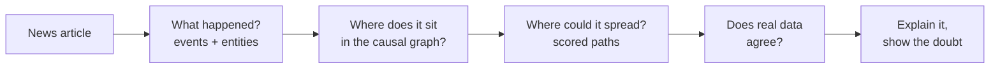
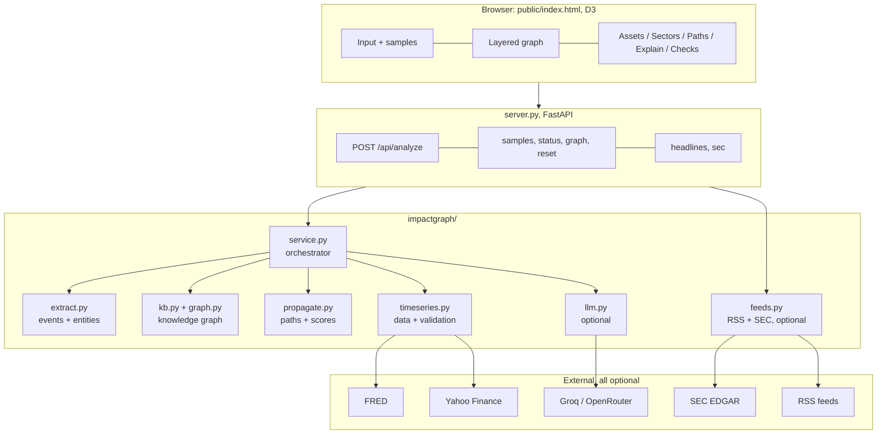
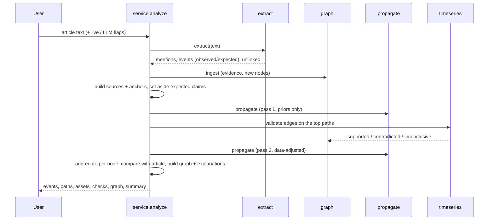

# Apex Zenith: idea, architecture and workflow

A design document for teammates. It explains the idea, why it is built this way, how the parts fit together, how one article flows through the system, and what is and is not proven so far.

**Contents**
1. [The idea in one page](#1-the-idea-in-one-page)
2. [Why this approach](#2-why-this-approach)
3. [Core concepts](#3-core-concepts)
4. [Architecture](#4-architecture)
5. [End-to-end workflow with a worked example](#5-end-to-end-workflow-with-a-worked-example)
6. [Knowledge graph design](#6-knowledge-graph-design)
7. [Extraction design](#7-extraction-design)
8. [Propagation engine](#8-propagation-engine)
9. [Time-series validation](#9-time-series-validation)
10. [The optional LLM layer](#10-the-optional-llm-layer)
11. [Explainability and uncertainty](#11-explainability-and-uncertainty)
12. [UI design](#12-ui-design)
13. [How the idea evolved](#13-how-the-idea-evolved)
14. [Honest status and limits](#14-honest-status-and-limits)
15. [Where to take it next](#15-where-to-take-it-next)

---

## 1. The idea in one page

**The problem.** Financial events rarely hit one company. Crude oil rising 12% pushes inflation expectations up, which shifts interest-rate expectations, which touches banks and real estate, which moves indices. News shows these as separate stories, so the reader rebuilds the chain by hand.

**The idea.** Keep a *knowledge graph of causal relationships* between economic things (commodities, indicators, sectors, companies, indices). When an article arrives:

1. Read it and find **what happened** (events) and **to whom** (entities).
2. Mark each event as **observed** (the text says it happened) or **expected** (hedged language).
3. Put the events on the graph and **push the shock outward** along the links, scoring every path.
4. **Check** the important links against real market data when available.
5. **Show** the result as a graph, with a plain-language reason for every connection, and with the uncertainty visible.

**The key principle.** The system never presents a guess as a fact. Anything the article states is *observed* and quoted. Everything the graph adds is *inferred* and labelled, and scores mean "how plausible", not "how likely".



## 2. Why this approach

We considered three ways to build "event → impact chain".

| Approach | Strength | Weakness | Verdict |
|---|---|---|---|
| **Ask an LLM directly** | Handles any phrasing, fluent explanations | Can invent links and numbers, not reproducible, hard to audit, needs a key and network | Use only as an optional helper |
| **Pure statistics** (learn links from price data) | Objective, data-driven | Correlation is not causation, no mechanism to explain, needs lots of clean data, silent on events with no history | Use as a *check*, not as the source |
| **Curated knowledge graph + rules + data checks** | Every link has a stated mechanism, deterministic, works offline, easy to audit and extend | Priors are hand-set, rules miss unusual phrasing | **Chosen as the core** |

The chosen design combines the three: the graph supplies *mechanisms*, rules supply *reproducible extraction*, data supplies *evidence*, and the LLM (optional) widens coverage and writes summaries under strict guardrails.

## 3. Core concepts

| Term | Meaning |
|---|---|
| **Node** | An economic thing: commodity, indicator, sector, company, index, instrument, institution, or event class. |
| **Edge** | A directed causal link with a **sign** (+1 moves with, −1 moves against), a **strength** (0–1), a typical **lag** in days, and a one-line **mechanism**. |
| **Event** | Something the article reports or expects: a price move, central-bank decision, OPEC+ decision, geopolitical shock, or regulation. |
| **Observed** | The text reports it as having happened. Quoted verbatim. |
| **Expected** | The text hedges it ("could", "analysts warn", "if"). Used to cross-check the graph, not as a trigger. |
| **Source** | A shock that starts propagation. |
| **Anchor** | An observed move on a node. Other paths *stop* there so the model can be compared with reality; the observed move is then traced onward. |
| **Path** | One chain of edges from a source to an affected node, with a score. |
| **Provenance** | Where an edge's support comes from: `prior`, `observed`, `inferred`, `validated`. |
| **Plausibility** | The heuristic score (0–1) shown to users. Not a probability and not a forecast. |
| **Mixed signals** | Paths to the same node disagree on direction. Flagged, never averaged away. |

Current seed graph: **56 entities** (15 companies, 13 sectors, 8 indicators, 5 commodities, 5 indices, 4 institutions, 4 instruments, 2 event classes) and **90 links**. 48 entities have a market-data series attached for validation. Coverage is US and India.

## 4. Architecture

### 4.1 Layers



### 4.2 Modules

| File | Responsibility |
|---|---|
| `impactgraph/kb.py` | The seed knowledge: entities, aliases, links with sign / strength / lag / mechanism, data-series candidates, market tags. |
| `impactgraph/extract.py` | Text → mentions, events (observed / expected), unlinked entities. Pure rules. |
| `impactgraph/graph.py` | Wraps a `networkx` graph. Ingests articles (evidence, reinforcement, inferred nodes), holds validation results, computes effective strength. |
| `impactgraph/propagate.py` | Depth-limited path search, anchors, market scope, per-node aggregation. |
| `impactgraph/timeseries.py` | Fetch FRED / Yahoo series, cache them, transform to returns, validate links by lagged correlation, simulated fallback, sparklines, macro snapshot. |
| `impactgraph/llm.py` | Optional event extraction and summary through an OpenAI-compatible API (Groq or OpenRouter). |
| `impactgraph/feeds.py` | Optional RSS headlines and SEC 8-K metadata. |
| `impactgraph/service.py` | Orchestrates one analysis end to end and shapes the response; holds the five sample articles. |
| `server.py` | HTTP API and static file serving. |
| `public/index.html` | The whole UI. |
| `tests/test_pipeline.py` | 22 offline tests: extraction, propagation, graph updates, end to end. |

### 4.3 API

| Endpoint | Purpose |
|---|---|
| `POST /api/analyze` `{text, live, use_llm}` | Run the full pipeline. |
| `GET /api/samples` | The five sample articles. |
| `GET /api/status` | Active LLM provider and graph statistics. |
| `GET /api/graph` | The full current graph. |
| `POST /api/reset` | Drop everything learned from articles. |
| `GET /api/headlines` | Public finance RSS headlines. |
| `GET /api/sec?ticker=` | Recent SEC 8-K filing metadata. |

The `analyze` response contains: `events`, `mentions`, `unlinked`, `graph_changes`, `sources`, `paths`, `assets`, `sectors`, `variables`, `comparison`, `graph` (nodes and links for drawing), `sparks`, `data_modes`, `macro`, `caveats`, `summary`.

## 5. End-to-end workflow with a worked example

### 5.1 Sequence



### 5.2 Worked example: the oil sample

**Input.** "Brent crude jumped 12% on Monday after an attack on tankers near the Strait of Hormuz raised fears of a supply disruption. OPEC+ signalled it would keep its output cuts in place. Analysts warned that higher energy costs could lift inflation expectations and push central banks to keep interest rates higher for longer. Airline stocks fell sharply, with Delta Air Lines among the biggest decliners, while ExxonMobil and ONGC gained. The rupee weakened as India's import bill is expected to widen."

**Step 1. Extraction.** Events found:

| Event | Status | Why |
|---|---|---|
| Crude Oil up 12% | observed | "jumped 12%" |
| Geopolitical escalation (attack) | observed | "an attack on tankers" |
| OPEC+ restrains output | observed | "signalled it would keep its output cuts" |
| Inflation Expectations up | **expected** | "analysts warned … could lift" |
| Airlines down, Delta down | observed | "fell sharply" |
| Exxon Mobil up, ONGC up | observed | "gained" |
| USD/INR up | observed | "rupee weakened" means USD/INR rose |

Note what it correctly does *not* do: "central banks" is not read as the Banks sector, and "the increase" style nouns are not read as moves.

**Step 2. Sources and anchors.** The geopolitical event and OPEC+ decision are *sources*. The observed price moves (crude, airlines, Delta, Exxon, ONGC, USD/INR) are *anchors*. The "inflation expectations could rise" statement is set aside as a *claim to check*.

**Step 3. Propagation.** Shocks spread along links. Example chains:

```
Crude Oil ↑ → Oil & Gas Producers ↑ → XLE (Energy ETF) ↑           score 0.74
Crude Oil ↑ → Inflation Expectations ↑ → Rate Expectations ↑ → Real Estate ↓
Geopolitical Tension ↑ → Risk Aversion ↑ → S&P 500 ↓
```

Paths from the geopolitical source stop when they reach crude oil (an anchor), so the graph's prediction for crude can be compared with what the article reports.

**Step 4. Validation (live data).** With live data on, the links on those paths are checked. Measured in one run on real FRED series:

| Link | Result | Correlation | Days |
|---|---|---|---|
| Crude oil → inflation expectations | supported | 0.48 | 504 |
| Inflation expectations → rate expectations | supported | 0.42 | 519 |
| Rate expectations → 10Y yield | supported | 0.79 | 520 |
| Risk aversion (VIX) → S&P 500 | supported | −0.84 | 505 |
| Rate expectations → S&P 500 | inconclusive | 0.09 | 515 |

**Step 5. Cross-check.** Each statement in the article is compared with the graph. For this sample, the graph agreed with all six observed moves and with the one expected claim ("inflation expectations rising"). When the graph disagrees, the Checks tab says so.

**Step 6. Output.** Ranked assets (airlines down, energy producers up), sectors, the layered graph, per-path explanations, and a short summary that keeps *Reported* and *Inferred* separate.

## 6. Knowledge graph design

### 6.1 What an edge means

> *Source rising pushes target up (+1) or down (−1), with typical plausibility `strength` and typical delay `lag` days, for the stated `mechanism`.*

Examples from the seed graph:

| From → To | Sign | Strength | Lag (d) | Mechanism |
|---|---|---|---|---|
| Crude oil → Inflation expectations | + | 0.75 | 7 | Energy is a direct CPI input and anchors headline inflation expectations |
| Crude oil → Airlines | − | 0.80 | 5 | Jet fuel is a large share of airline cost; hedging only partly offsets |
| Inflation expectations → Rate expectations | + | 0.70 | 14 | Higher expected inflation raises the odds central banks keep rates higher |
| Rate expectations → Real estate | − | 0.65 | 30 | Costlier mortgages and financing depress valuations and demand |
| Rate expectations → Banks | + | 0.35 | 30 | Wider margins, offset by credit-cost risk (deliberately weak: the sign is contested) |
| Crude oil → USD/INR | + | 0.40 | 7 | Oil importers such as India face a wider current-account deficit |

Strengths are **analyst priors**, not fitted coefficients. This is stated openly in the product.

### 6.2 How the graph learns from an article

- **Evidence.** If both ends of a link appear in one sentence, the sentence is stored on that edge, the edge gains `observed` provenance, and its strength rises by 5% of the gap to 0.97 (diminishing returns).
- **Idempotence.** Re-analysing the same article does not double count.
- **New entities.** An unknown company name ("Zephyr Airlines") becomes an **inferred** node. If its name hints at a sector, a low-confidence (0.5) inferred link from that sector is added.
- **Validation.** Data checks are stored on the edge and may adjust its effective strength (see section 9).
- **Reset.** One call returns the graph to its seed priors.

### 6.3 Market tags

Companies, indices and ETFs are tagged `US` or `IN`; sectors and indicators are `GLOBAL`. Regulatory events carry the regulator's market so an RBI rule does not propagate to US banks.

## 7. Extraction design

Deterministic and explainable: the same text always gives the same events.

1. **Entity mentions.** Each entity has aliases. Matching is longest-first, non-overlapping, with word boundaries. Aliases starting with `!` are case-sensitive (for example `!Fed`, `!Delta`, `!DLF`, so "fed" the verb and "delta" the word do not match).
2. **Sentences and clauses.** Text is split into sentences, and sentences into *clauses* at `;`, ", while", ", but", "as", "after", "amid". A verb only applies to entities in the **same clause**.
3. **Direction verbs.** Lists of up-verbs and down-verbs find the nearest verb to each entity (within 70 characters). Noun and adjective uses are rejected: a verb right after "the", "a", "its" is ignored ("the increase"), and "higher / lower / wider" only count as verbs when not followed by a noun ("higher capital requirements").
4. **Magnitude.** The nearest `%`, `bps` or "basis points" figure becomes the event's magnitude; intensity grows with size (`tanh`).
5. **Observed vs expected.** A hedge word before the verb ("could", "may", "warned", "if", "expected to", …) makes the event *expected*.
6. **Event rules.**
   - Price move: any entity of a market type with a nearby verb.
   - Central-bank decision: a named bank (Fed, RBI, ECB) plus a rate word plus a verb. Generic "central banks" is a mention only.
   - OPEC+: restraint phrases ("output cuts", "curb") mean supply restraint; boost phrases mean the opposite.
   - Geopolitical: strong words (attack, missile, blockade, sanctions, …) or weak words (war, conflict, tensions) plus a geopolitical place.
   - Regulation: regulatory vocabulary plus a sector or company, scoped to the regulator's market.
7. **Special cases.** "Rupee weakened" flips the direction onto USD/INR (the node measures rupee *weakness*).
8. **Unlinked entities.** Capitalised names ending in Inc / Corp / Airlines / Bank / … that match no known company; a sector word inside the name does not block detection.

Known blind spots: unusual phrasing, negation ("did not fall"), figures expressed in words, and multi-sentence causation. The optional LLM pass exists to widen coverage here.

## 8. Propagation engine

### 8.1 Path search

Depth-limited DFS (max 5 hops, no revisiting a node) from each source.

```
score(path) = Π strength(edge)  ×  Π decay(edge)   (decay = 1 on the first hop; per link 0.97 / 0.93 / 0.82 by data support, 0.92 if untested)
sign(path)  = source direction × Π sign(edge)
lag(path)   = Σ lag(edge)
drop paths with score < 0.04
```

Longer chains score lower automatically, which matches intuition: the further from the shock, the weaker and more uncertain the effect.

### 8.2 Anchors and double counting

Observed moves are anchors. For any other source, a path that reaches an anchor *stops there*. The anchor itself becomes a source with its observed direction. Two consequences:

- The graph's prediction for an observed node can be compared with the article.
- A cause event (for example a regulation) and the price move it caused on the same node are **merged**, so paths are not counted twice.

### 8.3 Market scope

A source with a market scope (an RBI rule → `IN`) only reaches nodes tagged with that market or `GLOBAL`.

### 8.4 Aggregation per node

For every node reached:

- `pos` and `neg` = total score of paths pushing it up / down.
- **Direction** = the larger side.
- **Agreement** = larger / (pos + neg). If agreement < 0.7 and the smaller side has weight ≥ 0.02, the node is flagged **mixed**.
- **Plausibility** = noisy-OR of the best four paths, capped at 0.92, multiplied by (0.5 + 0.5 × agreement).
- **Horizon** = lag of the best path. **Sensitivity** = intensity × best score, shown as mild / moderate / strong.

Why a cap and a penalty: noisy-OR assumes independent paths, but paths share edges, so it overstates confidence. The cap and the agreement penalty are deliberate corrections, not decoration.

### 8.5 Ordering for display

Paths are shown by an "interest" score: score, boosted for longer chains, halved for links that are pure membership (lag 0, such as sector → member company). This keeps informative chains above trivial ones.

## 9. Time-series validation

**Question asked of the data:** *do the two ends of this link actually move together, in the expected direction, at a plausible delay?*

**Method.**

1. Fetch daily series (about 2 years). Prices become log returns; rates, yields and breakevens use first differences.
2. Align the two series by date; require at least 120 overlapping points.
3. Compute correlation at lags 0 up to a window tied to the link's expected lag (at most 10 days). Take the strongest; among near-ties prefer the shortest lag.
4. Threshold for significance: `2.8 / √n`.
5. Verdict:

| Verdict | Condition | Effect on strength |
|---|---|---|
| supported | significant and sign as expected | × (1 + min(0.25, \|r\| / 2)) |
| contradicted | significant and sign opposite | × max(0.55, 1 − \|r\|) |
| inconclusive | below threshold | none |
| same_series | both ends use the same market series (e.g. sector → its ETF) | none; not independent evidence |
| no_data | a series is missing | none |

**Sources, in order.** FRED (no key; Brent, 5-year breakeven inflation, 2- and 10-year yields, dollar index, USD/INR, S&P 500, VIX, Henry Hub gas) → Yahoo Finance (sector ETFs, Indian stocks and indices, gold) → disk cache (6-hour freshness, stale accepted) → **simulated**.

**The simulated-data rule.** Simulated series exist only so the offline demo has something to draw. They are labelled *simulated* everywhere and have **no effect** on any confidence: validating a prior against data generated from that prior would be circular.

**Data-integrity safeguards.** Yahoo calls run one at a time (the library keeps shared global state); a fetch that returns data identical to another ticker's is rejected; after repeated failures Yahoo is skipped for 5 minutes so one throttled service cannot stall every analysis; FRED calls retry with backoff.

## 10. The optional LLM layer

Any OpenAI-compatible endpoint: **Groq** or **OpenRouter**, chosen by whichever key is set (`GROQ_API_KEY`, `OPENROUTER_API_KEY`). With no key, everything still works.

The model is allowed to do two things only:

1. **Extract extra events** as JSON mapped to known node ids. An event is rejected unless its quoted sentence actually appears in the article. LLM events carry an `LLM` badge.
2. **Write a 3–4 sentence summary** from facts the system hands it, in hedged language, with *reported* and *inferred* kept separate.

The model never creates links, strengths, scores or numbers. All scoring stays deterministic.

## 11. Explainability and uncertainty

Design rules, and where each shows up:

| Principle | Where it shows |
|---|---|
| Observed vs inferred is always distinct | Event badges, white rings on observed nodes, "fact / trigger" vs "inferred" steps in Explain |
| Every link has a stated mechanism | Explain tab, one line per step |
| Evidence is quoted, not paraphrased | Article sentences under the step they support |
| Provenance is explicit | `prior` / `observed` / `inferred` / `validated` badges |
| Data checks show their numbers | r, lag, sample size, and whether data was real or simulated |
| Scores are not probabilities | Disclaimer on every panel, "plausibility" wording |
| Disagreement is shown | "mixed signals" flag; Checks tab marks where the graph and article disagree |
| Doubt grows with distance | Per-hop decay; plausibility cap |

## 12. UI design

One page, three panels, plus a summary bar.

- **Left: input and extraction.** Text box, sample picker, *Live market data* and *LLM assist* toggles, text with entities underlined by type, event cards with observed / expected badges and quotes.
- **Center: the graph.** Layered left to right: events → sources → hop 1 → hop 2 → assets, so the flow of cause to effect reads naturally. Link colour = sign, thickness = strength, dashed = inferred or reported, white ring = observed, ± = mixed. Hover for details, drag nodes, click a link or node to explain it. **Animate propagation** reveals nodes by estimated lag (day 0, day 2, day 7 …).
- **Right: results in tabs.** *Assets*, *Sectors*, *Paths*, *Explain*, *Checks*.
- **Bottom: summary** and a collapsible "limits of this analysis".
- `#demo0` to `#demo4` in the URL auto-runs a sample, for rehearsal and screenshots.

Why a deterministic layered layout and not a force-directed one: the force layout became an unreadable tangle with 40+ nodes and did not settle reliably. The layered layout looks the same every time, which matters for a live demo.

## 13. How the idea evolved

A short log of design decisions and the problems that caused them.

| Problem found | Decision |
|---|---|
| "Central banks" was read as the Banks sector | Added a generic central-bank node that is a mention only, not a decision-maker |
| "Rupee weakened" pointed the wrong way | Direction flips for rupee aliases because the node measures rupee *weakness* |
| A verb in one clause moved an entity in another ("real estate fell, while … banks could benefit") | Clause boundaries; a verb applies only within its clause |
| "Higher capital requirements" and "the increase" read as moves | Noun / adjective filter for ambiguous words |
| A regulation and the price move it caused propagated twice | Merge a cause event into the observed move on the same node |
| An RBI rule propagated to JPMorgan | Market tags; regulatory events carry the regulator's market |
| Trivial "sector → member company" paths outranked informative chains | Display ranking halves lag-0 membership links and boosts multi-hop chains |
| "Zephyr Airlines" was not recognised as a new company because "Airlines" matches a sector | Only known companies and indices block a new-entity match |
| The market-data cache held identical data for unrelated tickers (a threaded fetch mixed them up) | Serialised Yahoo calls, duplicate-data guard, cache wiped; shared-state libraries are never called concurrently |
| Yahoo throttling made every analysis stall | Circuit breaker; FRED first wherever it has a series |
| Correlation of a sector with its own ETF looked like strong evidence | `same_series` verdict that does not count as evidence |
| Force-directed graph unreadable | Deterministic layered layout |

## 14. Honest status and limits

**Built and checked**

- Full pipeline runs offline for all five samples; 22 tests pass.
- The UI renders correctly for the oil and Fed samples (checked from screenshots); the page's JavaScript passes a syntax check.
- Live FRED validation works and gives sensible numbers (section 5.2).
- Headlines and SEC 8-K metadata endpoints return real data.

**Not yet verified**

- Yahoo Finance data after the data-mixing fix: Yahoo was throttling during testing, so the fix is untested against live Yahoo data. Until it is re-run, treat Yahoo-based verdicts as unconfirmed.
- The LLM layer has not run, since no key was available.
- Clicking through the Explain, Paths and Sectors tabs has not been exercised in a browser; only the first render was checked.

**Inherent limits**

- Link strengths are expert priors, not fitted values; data validation covers only links whose both ends have a series.
- Correlation is not causation, and relationships shift across regimes.
- The rule-based extractor handles common phrasing, not arbitrary prose; negation is not handled.
- The graph is small (56 entities, 90 links); coverage beyond oil, rates, risk sentiment, a handful of sectors and the US / India markets is thin.
- Not investment advice.

## 15. Where to take it next

Ordered roughly by value for effort.

1. **Re-verify the Yahoo path** and add an automated sanity check (no two tickers identical; known pairs such as gold vs its ETF highly correlated).
2. **Event-study checks.** For past events of the same type, measure how assets actually moved over the following days, and show that next to the graph's prediction.
3. **Negation and quantity handling** in the extractor ("did not fall", "a dozen percent").
4. **Editable graph.** Let a user add or change a link with a mechanism, and see it marked as user-supplied.
5. **Fit strengths from data** where the series support it, keeping the hand-set prior as the starting point and showing both.
6. **Filing-text evidence.** Pull a relevant passage from a company's latest annual report to support a link, quoted and attributed as the company's own statement.
7. **Portfolio view.** Enter holdings and see which impact chains reach them.
8. **Uncertainty ranges.** Replace single plausibility numbers with ranges derived from path disagreement and data fit.
9. **Wider coverage.** More sectors, commodities, countries and event types.
