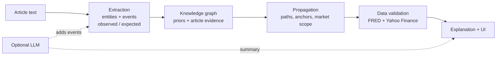

# PRD: Financial Event Impact Graph (Apex Zenith)

**Date:** 2026-10-10 · **Status:** Draft for team review · **Audience:** teammates joining the build

> Nothing described here exists yet. This document says what we will build, why, and how we will know it works.

---

## 1. Summary

We will build **Apex Zenith**, a web app that turns one piece of financial news into a live **dependency graph**. The graph shows how the event may spread through economic variables, sectors and assets. Every link is explained, every claim is labelled *observed* or *inferred*, and uncertainty is shown instead of hidden.

**The demo in one sentence:** paste "Brent crude jumped 12% after a tanker attack near Hormuz", and watch the system extract the entities, draw the chain *oil → inflation expectations → rate expectations → banks and real estate → indices and stocks*, and explain why each connection exists.

## 2. Problem and opportunity

Financial events rarely hit one company. An oil shock, a rate decision, a regulation or a conflict spreads through sectors and instruments. Most tools show news as separate stories, so the reader has to rebuild the chain of impact by hand. Tools that do predict often present outputs as certainties.

**Opportunity:** connect the stories into one explainable chain, and be explicit about what the article states versus what the system infers.

## 3. Goals, non-goals, success criteria

### Goals

1. Detect financial events in unstructured text.
2. Extract companies, commodities, sectors, indicators and instruments.
3. Identify and score relationships between them.
4. Build and keep updating a knowledge graph.
5. Trace plausible propagation paths and rank the affected assets.
6. Use time-series data where available to check relationships.
7. Explain each impact chain and the evidence behind it.
8. Separate observed facts from inferred relationships, and communicate uncertainty.

### Non-goals

- Price targets, trading signals or investment advice.
- Real-time streaming or full-market coverage.
- A statistically fitted or learned model. Link strengths are analyst priors, adjusted by evidence.
- Languages other than English.

### Success criteria (proposed targets, to confirm as a team)

| Criterion | Target |
|---|---|
| Five sample events run end to end offline, with no API key | 5 of 5 |
| Each sample returns events, at least 10 paths, and ranked assets | 5 of 5 |
| Extractor labels observed vs expected correctly on a 20-sentence test set | at least 90% |
| Time from "Analyse" to full result (offline) | under 3 s |
| Every path step shows mechanism, strength, lag and provenance | 100% |
| Live-data demo works, or falls back cleanly | no crash, clear label |

## 4. Users and use cases

| User | Need |
|---|---|
| **Hackathon judges** (primary) | See the idea work in a few minutes and trust what they see. |
| **Analysts and students** | Understand how one event could reach their holdings or sector. |
| **Teammates and maintainers** | Add entities, links and events without touching the engine. |

Use cases: (a) paste an article and see its impact chains; (b) click an asset to see why it appears; (c) check whether the graph agrees with moves the article already reports; (d) watch the graph learn from each new article.

## 5. Demo scenario

Input article (sample 1):

> Brent crude jumped 12% on Monday after an attack on tankers near the Strait of Hormuz raised fears of a supply disruption. OPEC+ signalled it would keep its output cuts in place. Analysts warned that higher energy costs could lift inflation expectations and push central banks to keep interest rates higher for longer. Airline stocks fell sharply, with Delta Air Lines among the biggest decliners, while ExxonMobil and ONGC gained. The rupee weakened as India's import bill is expected to widen.

Walkthrough:

1. **Extraction.** Entities are highlighted in the text. Events appear as cards tagged **observed** (crude +12%, attack, OPEC+ output cuts, airline and energy moves, rupee) or **expected** ("could lift inflation expectations").
2. **Graph.** A left-to-right graph shows events → sources → hop 1 → hop 2 → assets.
3. **Paths.** Multiple chains are listed, for example *Crude Oil ↑ → Inflation Expectations ↑ → Rate Expectations ↑ → Real Estate ↓*.
4. **Assets.** Ranked list with direction, plausibility, horizon and a "mixed signals" flag where paths disagree.
5. **Explain.** Click any path to see, per step, the mechanism, strength, lag, provenance and the article sentence that supports it.
6. **Cross-check.** A table compares what the article states with what the graph predicts (consistent / graph disagrees / mixed / no path).
7. **Learning.** A second article visibly strengthens links and can add a new, low-confidence company.

Four more samples cover a Fed hike, an RBI regulation, a gold rally on conflict, and a natural-gas spike.

## 6. Functional requirements

Priority: **P0** must ship, **P1** should ship, **P2** if time allows.

| ID | Requirement | Priority |
|---|---|---|
| F1 | Accept pasted text; offer sample events. | P0 |
| F2 | Detect entities (commodity, indicator, sector, company, index, instrument, central bank) with longest-match, case-aware aliases. | P0 |
| F3 | Detect event types: price move, central-bank decision, OPEC+ decision, geopolitical shock, regulation. | P0 |
| F4 | Tag every event **observed** or **expected** (hedged language), keep the quoted sentence and a confidence. | P0 |
| F5 | Handle direction correctly: "rupee weakened" means USD/INR up; ignore noun/adjective uses ("the increase", "higher capital requirements"); keep verbs inside their own clause. | P0 |
| F6 | Seed knowledge graph of 56 entities and 90 links, each with sign, strength (0–1), lag in days and one-line mechanism. US and India covered. | P0 |
| F7 | Update the graph per article: store evidence sentences on links, reinforce strength with diminishing returns, never double count the same article. | P0 |
| F8 | Add unknown companies as **inferred** nodes, with a sector guess from the name. | P1 |
| F9 | Propagate shocks with depth-limited multi-path search; score = product of link strengths with a per-hop decay. | P0 |
| F10 | Treat nodes the article reports as already moved as **anchors**: other paths stop there, and the observed move is traced onward. | P0 |
| F11 | Scope regulatory events to the regulator's market (RBI → India, not US banks). | P1 |
| F12 | Aggregate per asset: direction, plausibility, horizon, sensitivity, path count, and a **mixed** flag when paths conflict. | P0 |
| F13 | Compare article statements with the graph's prediction. | P0 |
| F14 | Validate links with time series (lagged correlation over about 2 years); label each link supported, contradicted or inconclusive; adjust confidence only with real data. | P1 |
| F15 | Explanation per path: mechanism, strength, lag, provenance (prior / observed / inferred / validated), data check, evidence quotes. | P0 |
| F16 | Optional LLM assist (Groq or OpenRouter): add missed events (quote must appear in the article) and write a short grounded summary. | P1 |
| F17 | Optional live headlines (RSS) and SEC 8-K filing metadata. | P2 |
| F18 | Reset button that drops everything learned from articles. | P1 |

## 7. System design

### Pipeline

### Data model

- **Node:** id, label, type, aliases, optional market-data series.
- **Edge:** sign (+1 / −1), strength, lag (days), mechanism, provenance list, evidence sentences, validation result.
- **Event:** type, trigger node, direction, intensity, status (observed / expected), confidence, quote, source (rules / LLM).
- **Path:** ordered nodes and edges, score, sign, total lag, source event.

### Scoring rules

- **Path score** = product of link strengths × 0.92 for each hop after the first. Paths below 0.04 are dropped; depth limit is 5 hops.
- **Asset plausibility** combines the best four paths (noisy-OR), is capped at 0.92, and is reduced when paths disagree.
- **Mixed signals** are flagged when the weaker direction carries at least 30% of the total path weight.
- **Horizon** is the sum of lags along the best path.
- Edge strength is multiplied by a data factor only when validation used **real** data.

These numbers are starting points. The team should tune them against the five samples.

## 8. Honesty and uncertainty rules

1. **Observed** means the text reports it as having happened. It is quoted next to the event. Everything downstream is **inferred** and labelled so.
2. Scores are **heuristic plausibility**, not probabilities and not forecasts. The UI says this on every results panel.
3. **Simulated** data may be used only when no real series is reachable. It is always labelled and **never** changes any confidence, because checking a prior against data generated from it would be circular.
4. Correlation is not causation. The data check reports the correlation, lag and sample size, not a claim of causality.
5. LLM output is optional, badged, and must quote the article. It never invents numbers or links.
6. Conflicting paths are shown as **mixed signals**, never averaged away.

## 9. Data sources and fallbacks

| Source | Used for | Needs key | Fallback |
|---|---|---|---|
| FRED (public CSV) | Brent, 5-year breakeven inflation, 2- and 10-year yields, dollar index, USD/INR, S&P 500, VIX, Henry Hub gas | No | Disk cache, then simulated (labelled) |
| Yahoo Finance | Sector ETFs, Indian stocks and indices, gold | No | Disk cache, then simulated (labelled) |
| Groq / OpenRouter | LLM assist | Yes (optional) | Rules only |
| Public RSS feeds | Live headlines | No | Hidden if unreachable |
| SEC EDGAR | 8-K filing metadata | Contact string in header | Hidden if unreachable |

Rules: cache live fetches for 6 hours; serialise Yahoo requests (the client library is not thread-safe); stop calling Yahoo for 5 minutes after repeated failures; reject a fetch that returns data identical to another ticker's.

## 10. UI requirements

Three panels plus a summary bar.

- **Left:** text box, sample picker, *Live market data* and *LLM assist* toggles, highlighted entities, event cards with observed/expected badges and quotes.
- **Center:** layered graph (events → sources → hop 1 → hop 2 → assets). Link colour shows sign, thickness shows strength, dashed means inferred or reported, white ring means observed, ± means mixed signals. Hover for details, drag nodes, **Animate propagation** by lag, **Show all** to reset.
- **Right (tabs):** Assets, Sectors, Paths, Explain, Checks (article vs graph, data used, macro backdrop, graph changes).
- **Bottom:** short summary and a collapsible "limits of this analysis".
- A `#demo0`–`#demo4` link auto-runs a sample, for rehearsals and screenshots.

## 11. Non-functional requirements and constraints

- Works fully **offline, with no API key**. Everything online is an optional upgrade.
- Python 3.9, FastAPI, networkx, D3 (vendored locally, no CDN dependency at demo time).
- Offline analysis returns in under 3 seconds; the first live-data run may take 1–2 minutes and is then cached.
- No secrets in the repository; keys come from environment variables.
- Unit and end-to-end tests run offline with `python -m unittest discover tests`.
- Every results panel shows a not-investment-advice notice.

## 12. Risks and open questions

| Risk | Impact | Mitigation |
|---|---|---|
| Yahoo Finance throttles or drops requests during the demo | Live checks unavailable | FRED-first series, 6-hour cache, warm the cache before the demo, labelled fallback |
| Rule-based extractor misses unusual phrasing | Missed events | Test set of tricky sentences; optional LLM pass |
| Hand-set link strengths look arbitrary | Credibility | Show strength and mechanism per link; show data check where available |
| Graph too crowded to read | Poor demo | Cap drawn paths, layered layout |
| Network flaky at the venue | Live mode fails | Offline mode is the default and complete |

**Open questions**

- Which LLM provider do we demo with, Groq or OpenRouter?
- Do we include the SEC and RSS extras, or cut them for time?
- Does the hackathon have rules about reusing existing code or data? Check before we finalise.
- Which market is the main story on stage, US, India, or both?

## 13. Milestones, ownership and acceptance checklist

Dates depend on the hackathon deadline, which we still need to confirm. Owners are to be assigned.

| Milestone | Scope | Owner |
|---|---|---|
| M1 Core pipeline (offline) | Knowledge base, extraction, propagation, tests on five samples | TBD |
| M2 UI | Three-panel layout, graph, assets, explain panel | TBD |
| M3 Data validation | FRED + Yahoo fetch, cache, edge validation, honest fallback | TBD |
| M4 Optional layers | LLM assist, headlines, SEC metadata | TBD |
| M5 Polish and rehearsal | Tuning, screenshots, demo script, dry run with network off | TBD |

**Acceptance checklist**

- [ ] All five samples run offline and produce events, paths and ranked assets
- [ ] Observed and expected events are visibly different in the UI and in the data
- [ ] Each path step shows mechanism, strength, lag and provenance
- [ ] The "Checks" tab compares article statements with the graph
- [ ] Simulated data is labelled and never changes confidence
- [ ] A second article visibly updates the graph
- [ ] Mixed-signal assets are flagged
- [ ] Tests pass offline
- [ ] The demo runs with the network off
- [ ] Not-investment-advice notice is visible on results
