# Apex Zenith — Financial Event Impact Graph & Multi-Asset Contagion Engine

[](https://www.python.org/)
[](https://fastapi.tiangolo.com/)
[](https://react.dev/)
[](https://vitejs.dev/)
[](tests/)
[](#4-tier-hierarchical-knowledge-graph)

**Apex Zenith** transforms raw financial news, central bank statements, regulatory filings, and commodity shocks into a **grounded, transparent causal dependency graph**. It traces how macro shocks propagate through economic variables, industry sectors, and tradable assets—validating every causal link against empirical market data, quantifying risk with Monte Carlo simulations and historical analogs, and discovering algorithmic hedges for investor portfolios.

> **Example Causal Cascade:**  
> `Brent Crude +12%` → `Inflation Expectations ↑` → `10Y Yields ↑` → `Refinancing Costs ↑` → `Airlines & Real Estate ↓` / `Energy Producers ↑` → `DAL, DLF, SPY Impact Assessment`

---

## Architecture & Data Flow

```mermaid
flowchart TD
    subgraph INGESTION["1. News and Event Ingestion Layer"]
        A1["Live RSS and NewsAPI Feeds"] --> B1["Text Preprocessing and Normalization"]
        A2["SEC 8-K Regulatory Filings"] --> B1
        A3["Interactive What-If Scenario Shocks"] --> B1
        B1 --> B2["Entity and Event Extraction Engine"]
        B2 -->|"Rule-Based NER"| B3["Standardized Entities and Shocks"]
        B2 -->|"LLM Proposer"| B4["Verbatim Quote Verification"]
        B4 -->|"Verbatim Match in Source"| B3
    end

    subgraph GRAPH["2. 4-Tier Hierarchical Knowledge Graph"]
        T0["Tier 0: Policy and Geopolitical Events<br/>OPEC+, Central Banks, Geopolitical Shocks"]
        T1["Tier 1: Macro Variables and Commodities<br/>Brent, Henry Hub Gas, US10Y, Inflation Exp"]
        T2["Tier 2: Industry Sectors<br/>Airlines, Technology, Energy, Banking"]
        T3["Tier 3: Tradable Assets and Instruments<br/>DAL, NVDA, XOM, SPY, Nifty 50"]

        T0 -->|"causes / policy reaction"| T1
        T1 -->|"causes / tracks"| T2
        T2 -->|"member of / weight in"| T3
        T2 -.->|"feedback loops: credit and growth"| T1
    end

    subgraph ENGINES["3. Analytical and Quantitative Simulation Engines"]
        E1["Depth-Limited DAG Propagation<br/>Empirical Attenuation Decay"]
        E2["Empirical Time Series Validation<br/>FRED and Yahoo Cross-Correlation"]
        E3["Historical Analogs Engine<br/>5-Day Sliding Return Scan, Base-100"]
        E4["Monte Carlo Volatility Fan<br/>500 GBM Paths, Zero Drift, VaR95, CVaR95"]
        E5["Portfolio Contagion and Hedge Finder<br/>Reverse DAG Traversal, Risk Offsets"]
        E6["Citable KG Assistant and RAG<br/>Structured Cards: n:, l:, p:, s:, t:"]
    end

    subgraph PRESENTATION["4. Presentation and Real-Time Streaming Layer"]
        UI1["Interactive Network Graph Canvas"]
        UI2["Historical Analogs and Volatility Fan"]
        UI3["Portfolio Contagion Matrix and Hedge Recommendations"]
        UI4["Grounded AI Assistant with Citations"]
        UI5["Live SSE Market Stream via Yahoo and FRED"]
    end

    %% Causal Links between pipeline stages
    B3 -->|"Map Observed Shocks"| T0
    B3 -->|"Anchor Shocks"| T1
    T3 -->|"Shock Inputs"| E1
    T1 -->|"Correlation Check"| E2
    E1 --> E3
    E1 --> E4
    E1 --> E5
    T3 --> E5
    T0 --> E6
    T1 --> E6
    T2 --> E6
    T3 --> E6

    E1 --> UI1
    E3 --> UI2
    E4 --> UI2
    E5 --> UI3
    E6 --> UI4
    E2 --> UI5
```




---

## Core Capabilities & Engines

### 1. 4-Tier Hierarchical Knowledge Graph (`impactgraph/hierarchy.py`, `kb.py`)
Organized systematically across four economic layers to ensure structural rigor and eliminate nonsensical cycles:
* **Tier 0 (Events & Policy):** Central bank rate decisions, OPEC+ production quotas, regulatory actions, and geopolitical escalations.
* **Tier 1 (Economic Variables & Commodities):** Brent Crude, Henry Hub Natural Gas, US 10-Year Yield, Inflation Expectations, US Dollar Index.
* **Tier 2 (Industry Sectors):** Airlines, Energy Producers, Technology, Real Estate, Banking.
* **Tier 3 (Tradable Assets):** Individual stocks (`DAL`, `NVDA`, `XOM`), broad indices (`SPY`, `NIFTY_50`), and ETFs.

Every link is characterized by:
- **Relation Type:** `causes`, `policy_reaction`, `member_of`, `tracks`, or `weight_in`.
- **Directional Sign & Strength:** Signed impact weight $[-1.0, +1.0]$ with empirical per-hop decay.
- **Causal Mechanism:** Explicit human-auditable economic rationale.
- **Typical Lag:** Real-world transmission timeframe (e.g., immediate, 1–5 days, 1–4 weeks).

### 2. Depth-Limited DAG Propagation (`impactgraph/propagate.py`)
- Traverses multi-path cascades using an attenuation decay factor.
- **Anchor Nodes:** Identifies assets or variables the source article reports as *already moved* (observed facts). Downstream paths treat these as boundary anchors, comparing predicted transmission with observed reality.
- **Contradiction Detection:** Explicitly flags assets subjected to conflicting signals across diverging transmission paths (e.g., higher interest rates boosting bank net interest margins while simultaneously depressing credit demand).

### 3. Empirical Time Series Validation (`impactgraph/timeseries.py`)
- Cross-references causal links against ~2 years of daily data fetched from **FRED** and **Yahoo Finance**.
- Computes rolling cross-correlations at plausible economic lags.
- Labels links as `supported`, `contradicted`, or `inconclusive`. If live data is unavailable, simulated fallback data is strictly labeled and never modifies Bayesian link confidence.

### 4. Historical Analogs Engine (`impactgraph/analogs.py`)
- Conducts a 5-day sliding window scan across historical market data to find past macro episodes exhibiting similar cumulative shock magnitude.
- De-duplicates candidate episodes within a 20-day window to isolate distinct market regimes.
- Normalizes trajectories to **Base 100** at $T=0$, projecting post-event paths ($T+1$ through $T+10$) to contextualize current shocks against past reality.

### 5. Monte Carlo Volatility Fan (`impactgraph/forecast.py`)
- Simulates 500 stochastic paths using **Geometric Brownian Motion (GBM)** over a 10-day forward horizon.
- Employs a **zero-drift assumption** ($\mu = 0$) to model unbiased volatility expansion around the predicted shock level.
- Computes distribution percentiles ($P_{10}$, $P_{25}$, $P_{50}$, $P_{75}$, $P_{90}$) and rigorous downside risk metrics:
  - **VaR 95 (Value at Risk):** The 5th percentile worst-case loss threshold over the simulation horizon.
  - **CVaR 95 (Conditional Value at Risk / Expected Shortfall):** The mean loss in the extreme 5% left tail.

### 6. Portfolio Contagion & Reverse Hedge Finder (`impactgraph/hedge.py`)
- Evaluates multi-asset portfolios against propagating macro shocks, computing weighted net exposure.
- Executes reverse graph traversal to identify defensive hedges:
  - Discovers inversely correlated assets or sectors with negative transmission coefficients to the dominant shock.
  - Generates actionable hedge allocation suggestions to neutralize net drawdown.

### 7. Citation-Grounded KG Assistant (`impactgraph/assistant.py`, `cards.py`)
- Answers natural-language analytical questions strictly from knowledge graph facts.
- Deconstructs graph entities into citable text cards (`n:<node>`, `l:<from>><to>`, `p:<path>`, `s:<sector>`, `t:<tier>`).
- Enforces strict quote verification: answers must cite real graph cards; unsupported claims or hallucinations are automatically stripped.
- Knows every entity and relationship in the live graph, including companies learned from articles, and tolerates typos; a keyword search over every card and a whole-graph overview answer questions that name nothing.
- Understands events and their direction ("an interest hike", "RBI cuts rates", "a recession", "the rupee falls", "a market crash") and runs them through the graph as a labelled what-if.
- Understands names the graph does not contain (people, brands, events): well-known people directly, anything else mapped by the language model to the closest graph entity, with the reason shown ("Read as: Elon Musk → Autos").
- Knows which news graph is open: "this story" means that one. If the graph cannot answer, that specific article answers (quotes checked); with no AI at all, the graph's facts and the article's best sentences answer. Every answer is labelled with where it came from.

### 8. Dynamic Knowledge Base & Rollback Guard (`impactgraph/kbstate.py`, `changelog.py`)
- Dynamically learns new entities and links from ingested articles while safeguarding core baseline integrity.
- Runs automated regression tests on every update: if a learned edge contradicts curated baselines or violates tier rules, the state is immediately reverted.
- Maintains a full versioned audit trail (`GET /api/kb/history`).

### 9. Relationships Explained in Plain English (`impactgraph/explain.py`)
- Every relationship drawn for an event carries a short explanation built only from what the graph stores on that link.
- Five parts: what it says (*"A rise in Crude Oil tends to push the Airlines sector down."*), why it exists, how it was identified (analyst prior, article sentences, a quote-verified LLM reading, user edits), what market data says (agrees or disagrees, with correlation, days and lag), and how the score is calculated step by step (*"starts at 0.80, set by the analyst; market data raised it by 16% to 0.93"*).
- Shown on the Impact Graph page in the **Identify and score relationships between entities** table (one row per relationship, with how it was identified, the market-data check and the score arithmetic), in the **Relationships** tab, and when a link is clicked.

### 10. Impact Chains Explained with Their Evidence (`impactgraph/explain.py`)
- Every impact chain is told step by step in plain English (*"A rise in Crude Oil pushes Inflation Expectations up, because ...; that rise in Inflation Expectations pushes Interest-Rate Expectations up, because ..."*), starting from what the article says.
- For each step: who identified it (analyst, article, LLM, user), what market data says, and any article quote; for the chain: an evidence summary, the score multiplied out, the weakest step, and a conclusion labelled as an inference (or whether it agrees with a move the article reports).
- Shown on the Impact Graph page in the **Explain each impact chain and the evidence behind it** section.

### 11. A Graph for Every Financial Story (`impactgraph/context.py`)
- A story that names a company but states no move (an IPO, a stake purchase, a new branch network) gets a **context graph** instead of an empty screen: the company, its sector, sector peers, the index, and what usually moves that sector.
- Companies the graph does not know are read by the LLM (name checked against the text, sector, corporate event) and learned in their sector in dynamic mode.
- It also gets **conditional chains** with their evidence (*if interest-rate expectations rise → banks → HDFC Bank*), clearly labelled: the article states no move, so no impact is claimed.
- No direction or impact is claimed; the page and the chat card say so. Non-financial stories (sports, celebrity) still get an honest explanation, not an invented graph.

---

## Quickstart & Installation

### Prerequisites
- Python 3.10+
- Node.js 18+ & npm
- (Optional) API keys for Groq, OpenRouter, FRED, or NewsAPI

### 1. Backend Setup

```bash
# Clone the repository
git clone https://github.com/Siddhi-Bhosale/hackwave3.0.git
cd hackwave3.0/Siddhi-Bhosale

# Set up Python virtual environment
python -m venv .venv
# Windows:
.\.venv\Scripts\activate
# Linux/macOS:
source .venv/bin/activate

# Install dependencies
pip install -r requirements.txt

# Configure environment variables
cp .env.example .env
```

### 2. Configure Environment (`.env`)

| Variable | Description | Default / Requirement |
|---|---|---|
| `GROQ_API_KEY` | High-speed LLM extraction & quote verification | Recommended (e.g. `llama-3.3-70b-versatile`) |
| `OPENROUTER_API_KEY` | Alternative LLM provider fallback | Optional fallback |
| `ZENITH_REQUIRE_LLM` | Set `0` for offline deterministic rules-only mode | `1` (production), `0` (tests) |
| `FRED_API_KEY` | Official Federal Reserve Economic Data access | Optional (falls back to FRED public CSVs) |
| `NEWSAPI_KEY` | NewsAPI live headline ingestion | Optional (falls back to curated RSS feeds) |
| `ZENITH_SEC_CONTACT` | User-Agent contact header for SEC EDGAR 8-K API | e.g. `Research/1.0 (contact@example.com)` |

### 3. Launching the System

```bash
# Start FastAPI backend (http://127.0.0.1:8000)
python run.py
```

In a separate terminal, launch the modern Vite/React user interface:

```bash
# Start Frontend Dev Server (http://localhost:5173)
cd frontend
npm install
npm run dev
```

Visit **`http://localhost:5173`** for the full interactive glassmorphic application, or **`http://127.0.0.1:8000`** for the standalone backend and API docs (`/docs`).

### 4. Running the Test Suite

```bash
# Execute all 280 automated unit and integration tests
python -m unittest discover tests
```

---

## API Reference Overview

| Endpoint | Method | Description |
|---|---|---|
| `/api/analyze` | `POST` | Ingests news text/shocks; extracts events, propagates causal DAG, validates time series. |
| `/api/whatif` | `POST` | Simulates hypothetical price/macro shocks (e.g. `brent_crude: +15%`) across the graph. |
| `/api/analogs` | `GET` | Retrieves historical 5-day rolling analog episodes with Base-100 normalized trajectories. |
| `/api/forecast` | `GET` | Runs 500-path Monte Carlo GBM simulation with VaR95 and CVaR95 risk statistics. |
| `/api/portfolio/hedge` | `POST` | Computes portfolio contagion impact and suggests counter-balancing reverse hedges. |
| `/api/assistant` | `POST` | Grounded Q&A: graph cards with checked citations, the open story's article as backup, never empty for a graph or story question. |
| `/api/stream` | `GET` | Server-Sent Events (SSE) stream for real-time market ticks via Yahoo Finance WebSocket. |
| `/api/quotes` | `GET` | Batched polling fallback for live quote prices and daily percentage changes. |
| `/api/hierarchy` | `GET` | Audits the 4-tier graph layout and inspects tier cross-link boundaries. |
| `/api/kg/cards` | `GET` | Exports the knowledge graph as structured, citable text cards. |
| `/api/kg/explain` | `GET` | One relationship in plain English (`?src=&dst=`): what it says, why, how it was identified, the data check, how it is scored. |
| `/api/kb/history` | `GET` | Returns versioned audit history of all manual and dynamic graph modifications. |

---

## Epistemological Boundaries & Honest Limits

1. **Observed vs. Inferred:**  
   Every event flagged as **Observed** is anchored to a verbatim quotation from the source text. Downstream nodes are explicitly marked as **Inferred** and scored via Bayesian path plausibility.
2. **Plausibility $\neq$ Deterministic Forecast:**  
   Propagation scores reflect heuristic plausibility derived from analyst priors and empirical cross-correlations—not guaranteed financial returns or investment advice.
3. **Strict Non-Circularity:**  
   Synthetic or simulated market data is explicitly tagged and strictly barred from updating link confidences to prevent circular confirmation bias.
4. **Regime Dependence:**  
   Macro relationships can decouple during structural regime shifts (e.g., stagflation vs. disinflationary growth). The system flags diverging paths as `mixed signals`.

---

## License & Citation

Apex Zenith is distributed under the MIT License. See [DOCUMENTATION.md](DOCUMENTATION.md) and [research/PAPER.md](research/PAPER.md) for full mathematical formulations, experimental methodology, and ablation benchmarks.
